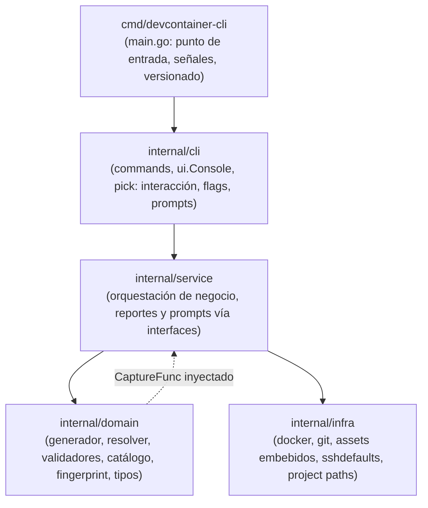

# Arquitectura del Sistema

Este documento describe la arquitectura técnica, las fronteras entre capas, los contratos transversales y las decisiones arquitectónicas fundamentales (`D1..Dn`) de `devcontainer-cli`.

---

## 1. Visión General y Diagrama de Capas

El diseño del proyecto sigue una arquitectura estricta en 4 capas desacopladas por responsabilidad. Una capa solo puede importar las capas inferiores, nunca las superiores. Todo el código interno reside en paquetes bajo `internal/`, impidiendo importaciones externas.



### Tabla de Responsabilidades por Capa

| Capa | Paquete | Propósito y Reglas Estrictas |
|---|---|---|
| **Punto de Entrada** | `cmd/devcontainer-cli` | Enrutamiento de señal SIGINT/SIGTERM (código de salida 130), inyección de versión por ldflags, inicialización del comando raíz y mapeo de errores a códigos de salida. Cero lógica de negocio. |
| **Interacción** | `internal/cli` | Definición de comandos Cobra (`cli/commands`), prompts interactivos (`cli/ui`), selector de contenedores (`cli/pick`). Parsea banderas y delega toda la lógica a `internal/service`. **Tiene prohibido importar `infra/docker` u `os/exec`.** |
| **Servicio** | `internal/service` | Orquesta los casos de uso coordinando llamadas a `domain` e `infra`. Emite mensajes y solicita entradas únicamente a través de las interfaces `Reporter` y `Prompter`. **Puede importar `domain` e `infra`; tiene prohibido importar `cli`.** |
| **Dominio** | `internal/domain` | Reglas puras de generación de Dockerfile y Compose, resolución de dependencias entre módulos, validaciones, cálculo de huella digital, cálculo de subredes y tipos del sistema. **Tiene prohibido importar `infra` o `cli`.** |
| **Infraestructura** | `internal/infra` | Ejecución de procesos Docker (`infra/docker`), comandos Git (`infra/git`), extracción de assets embebidos (`infra/assets`), valores por defecto SSH (`infra/sshdefaults`) y resolución de rutas de proyecto (`infra/project`). **Tiene prohibido importar `domain` o `cli`.** |

---

## 2. Fronteras e Interfaces de Aislamiento

### Inyección de Consultas Docker (`CaptureFunc`)
Las funciones de dominio que necesitan consultar información del daemon de Docker (ej. lista de subredes ocupadas o existencia de imágenes) no importan `infra/docker`. En su lugar, reciben un parámetro funcional:

```go
type CaptureFunc func(args []string) (status int, stdout, stderr string)
```

La capa de servicio provee la clausura que envuelve `docker.DockerCapture`. Esto permite probar cualquier función de dominio sin invocar procesos reales de Docker.

### Interfaces de Entrada y Salida (`service.Reporter` y `service.Prompter`)
Los servicios no imprimen en consola directamente ni leen stdin. Interactúan exclusivamente mediante:
- `Reporter`: `Info`, `Warn`, `Success`, `Error`, `Fatal`, `Debug`.
- `Prompter`: `Ask`, `Confirm`, `Select`, `Multiselect`, y `Wizard(build func(*State) []Step)`.

La implementación única de terminal es `ui.Console{}` (`internal/cli/ui`). En pruebas unitarias, se utilizan fakes como `nopReporter` y `scriptedPrompter`.

---

## 3. Mecanismos Transversales Críticos

### El Entorno del Contenedor se Declara como Datos, no como Texto
`PATH` y las variables de entorno pertenecen al entorno del proceso, no a las configuraciones de la shell. Un módulo declara su entorno mediante `dockerfile.ModuleSpec.ProvidesEnv func(opts) ContainerEnv`.

El generador compila este modelo de datos a múltiples destinos:
1. Directiva `ENV` en el `Dockerfile`: alcanza a todos los procesos sin necesidad de invocar una shell (ej. `devcontainer-cli shell -- uv pip install x`).
2. Script `~/.dc-env.sh`: exporta variables para shells interactivas y sesiones SSH no interactivas (`.zshenv`).

### Aislamiento de Workspace por Repositorio
Cada repositorio se monta en `/workspaces/<workspace>`. El entrypoint crea un enlace simbólico de conveniencia en `/workspace/<workspace>`. Nunca existe un `/workspace` compartido plano entre múltiples proyectos, lo cual impediría que herramientas de IA mezclen sus historiales de conversación indexados por ruta.

### Arquitectura de Configuración Compartida (`devcontainer-shared-config`)
El volumen `devcontainer-shared-config` almacena credenciales de usuario de forma plana (`claude`, `agents`, `gh`). Dos mecanismos evitan enlaces rotos entre la estructura plana del volumen y el directorio personal del contenedor:
1. **Alias con forma de home en la raíz del volumen**: enlaces como `.claude -> claude` creados tanto por el entrypoint como por el asistente de sincronización.
2. **`link_or_keep`**: primitiva en shell que respeta archivos reales preexistentes y crea enlaces simbólicos sin sobrescribir datos del usuario.

### Contrato de Python y uv
Para garantizar que `uv pip install` funcione limpiamente en el contenedor:
1. `UV_SYSTEM_PYTHON=1`: selecciona el intérprete del contenedor en lugar de forzar un entorno virtual.
2. `UV_BREAK_SYSTEM_PACKAGES=1`: sortea las restricciones de PEP 668 en Ubuntu 24.04.
3. `chown` no recursivo: asigna permisos de escritura a `devuser` sobre las rutas dinámicas provistas por `sysconfig.get_path("purelib")` y `("scripts")`.
4. Queda prohibido declarar `VIRTUAL_ENV` a nivel de imagen para no generar advertencias en proyectos que usan `uv add` o `uv run`.

### Ciclo de Vida del Entrypoint (`entrypoint.sh`)
El entrypoint ejecuta una secuencia determinista de funciones de etapa en una única instancia de shell:
```
stage_users → stage_workspace → stage_identity → stage_shared_config
  → stage_user_aliases → stage_context_skill → stage_post_scripts
  → stage_services → exec sshd
```
El orden es estricto: `stage_workspace` determina el UID/GID de devuser; `stage_identity` configura el propietario del volumen compartido; `stage_shared_config` monta las credenciales antes de enlazar alias y habilidades.

---

## 4. Decisiones de Arquitectura (`D1..Dn`)

### D1: Reescribir la CLI en Go sobre Cobra
- **Contexto**: La implementación previa en TypeScript/Node (`cli-ts-legacy/`) requería un runtime pesado de Node.js en el host y complicaba la distribución de binarios ligeros e independientes.
- **Decisión**: Reescribir completamente la CLI en Go 1.26 utilizando `spf13/cobra`.
- **Consecuencias**: Binarios autocontenidos sin dependencias externas en el host, tiempos de ejecución inmediatos y compilación cruzada nativa para Linux y macOS.

### D2: Separación Estricta en 4 Capas con Prohibición de Dependencias Hacia Arriba
- **Contexto**: El acoplamiento entre comandos, lógica de negocio y ejecución de comandos del sistema generaba efectos secundarios y dificultaba las pruebas automatizadas.
- **Decisión**: Prohibir llamadas directas a Docker o comandos del sistema operativo desde la capa `cli/commands`. Toda la lógica reside en `service`, y el acceso a Docker se centraliza en `infra/docker`.
- **Consecuencias**: Cobertura de pruebas completa mediante mocks en memoria (`docker.SetRunner`), sin necesidad de un daemon de Docker real en tests unitarios.

### D3: Prohibición de Interacción Directa con Docker para Agentes de IA
- **Contexto**: Agentes externos ejecutando comandos directos de `docker` o modificando archivos en `.dc_<workspace>/` corrompen los estados gestionados y los mapeos de puertos.
- **Decisión**: Establecer como regla inviolable que los agentes operen a través de los subcomandos de `devcontainer-cli agent`.
- **Consecuencias**: Mantenimiento de los invariantes del workspace, puertos limpios y cierre determinista de contenedores.

### D4: Inyección Funcional de Consultas en Dominio (`CaptureFunc`)
- **Contexto**: La capa de dominio requería inspeccionar recursos existentes en Docker (como subredes utilizadas) sin violar la regla de no importar infraestructura.
- **Decisión**: Pasar clausuras `CaptureFunc` a las funciones de dominio que requieren datos de Docker.
- **Consecuencias**: Capa de dominio 100% pura y verificable con tablas de pruebas sin tocar el sistema de archivos ni la red.

### D5: Declaración de Variables de Entorno como Datos
- **Contexto**: Definir variables de entorno en scripts de shell como `.bashrc` impedía que procesos ejecutados sin shell (`docker exec` directo o runners desatendidos) encontraran binarios instalados por los módulos.
- **Decisión**: Modelar el entorno en estructuras Go (`ProvidesEnv`) y compilarlo simultáneamente en directivas `ENV` de Dockerfile y en `~/.dc-env.sh`.
- **Consecuencias**: Coherencia absoluta de `PATH` y variables en cualquier contexto de ejecución (shell interactiva, SSH, ejecución de comandos aislados).

### D6: Aislamiento de Workspace por Proyecto (`/workspaces/<ws>`)
- **Contexto**: Si todos los proyectos compartieran una ruta idéntica `/workspace`, los agentes de IA que guardan historial de chat asociado al directorio de inicio mezclarían los contextos de distintos repositorios.
- **Decisión**: Montar cada proyecto en `/workspaces/<nombre>` y proveer un enlace simbólico complementario en `/workspace/<nombre>`.
- **Consecuencias**: Separación estricta de historiales de sesión y preservación de memoria contextual limpia en herramientas de IA.

### D7: Volumen Compartido Plano con Proyección de Home
- **Contexto**: Diferentes herramientas esperan sus configuraciones en distintas ubicaciones del home (`~/.claude`, `~/.config/gh`), pero sincronizarlas en un volumen plano generaba enlaces relativos rotos.
- **Decisión**: Estructurar el volumen con identificadores planos (`claude`, `gh`) y generar alias con forma de home dentro del volumen, utilizando `link_or_keep` para enlazar hacia el home del usuario.
- **Consecuencias**: Persistencia fiable de sesiones de herramientas entre reinicios y recreaciones de contenedores.

### D8: Entrypoint con Etapas Nombradas en Shell
- **Contexto**: Un directorio con scripts sueltos estilo `/etc/entrypoint.d/` dificultaba compartir estado y sincronizar dependencias de inicialización críticas.
- **Decisión**: Implementar el entrypoint como un script único con funciones `stage_*` secuenciales y orden explícito.
- **Consecuencias**: Claridad en la secuencia de arranque, facilidad para probar funciones aisladas en tests unitarios y eliminación de condiciones de carrera en el montaje de permisos.

### D9: Contrato Quirúrgico de Python y `uv`
- **Contexto**: Ubuntu 24.04 bloquea instalaciones globales mediante PEP 668, y el uso de entornos virtuales predeterminados a nivel de imagen genera advertencias continuas al trabajar en proyectos basados en `uv`.
- **Decisión**: Configurar `UV_SYSTEM_PYTHON=1`, `UV_BREAK_SYSTEM_PACKAGES=1` y aplicar `chown` específico a las carpetas devueltas por el intérprete sin forzar un `VIRTUAL_ENV` global.
- **Consecuencias**: Operación natural tanto para comandos de proyecto (`uv add`, `uv run`) como para herramientas globales (`uv tool install`) o librerías de sistema (`uv pip install`).

### D10: Generación Dinámica de `~/CONTEXT.md`
- **Contexto**: Los agentes necesitan orientación sobre el contenido real del contenedor, pero documentos estáticos caen en obsolescencia respecto a los módulos seleccionados.
- **Decisión**: Ensamblar `~/CONTEXT.md` en tiempo de construcción a partir de las secciones declaradas por cada módulo y servicio activo.
- **Consecuencias**: Documentación exacta, verificable y libre de discrepancias para cada contenedor generado.

### D11: Habilidades de Agente con Alcance de Proyecto
- **Contexto**: Instalar habilidades globales mediante `npx skills add -g` escribía en el volumen compartido, filtrando herramientas de un proyecto a todos los demás contenedores del usuario.
- **Decisión**: Declarar habilidades en `skills.yml` y ejecutarlas dentro del montaje del workspace del proyecto, usando variables de entorno de compose (`DEVCONTAINER_SKILLS`) sin alterar la imagen base.
- **Consecuencias**: Proyectos independientes, reproducibles y sin contaminación cruzada de habilidades.

### D12: Fachada de Agente con Políticas Defensivas Estrictas
- **Contexto**: Ejecutar comandos interactivos o con permisos de root de forma desatendida provoca bloqueos indefinidos o corrupción de permisos en el checkout del host.
- **Decisión**: Crear el grupo `devcontainer-cli agent` con ejecución forzada como `devuser`, prohibición de prompts interactivos y fallos inmediatos ante parámetros faltantes.
- **Consecuencias**: Seguridad operativa absoluta para agentes autónomos.

### D13: Archivo de Configuración SSH Propio y Aislado
- **Contexto**: Modificar directamente `~/.ssh/config` del usuario anfitrión genera riesgo de corrupción de configuración o colisiones con conexiones personales.
- **Decisión**: Escribir todos los bloques gestionados en `~/.ssh/devcontainer-cli.config` y vincularlo mediante una única directiva `Include` al inicio de `~/.ssh/config`.
- **Consecuencias**: Aislamiento seguro, limpieza trivial de alias obsoletos y cero interferencia con la configuración personal del anfitrión.
