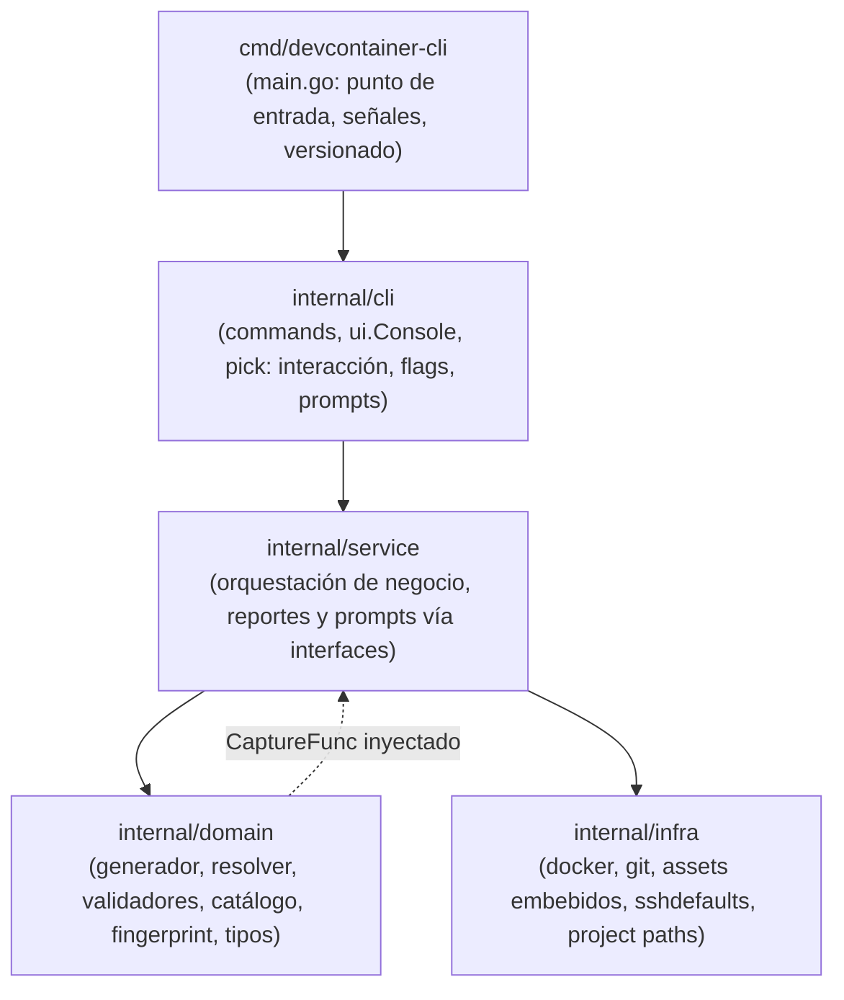

# Arquitectura del Sistema

Este documento describe la arquitectura técnica, las fronteras entre capas, los contratos transversales y las decisiones arquitectónicas fundamentales (`D1..Dn`) de `devcontainer-cli`.

---

## 1. Visión General y Diagrama de Capas

El diseño del proyecto sigue una arquitectura estricta en 4 capas desacopladas por responsabilidad. Una capa solo puede importar las capas inferiores, nunca las superiores. Todo el código interno reside en paquetes bajo `internal/`, impidiendo importaciones externas.



### Tabla de Responsabilidades por Capa

| Capa | Paquete | Propósito y Reglas Estrictas |
|---|---|---|
| **Punto de Entrada** | `cmd/devcontainer-cli` | Enrutamiento de señal SIGINT/SIGTERM (código de salida 130), inyección de versión por ldflags, inicialización del comando raíz y mapeo de errores a códigos de salida. Cero lógica de negocio. |
| **Interacción** | `internal/cli` | Definición de comandos Cobra (`cli/commands`), prompts interactivos (`cli/ui`), selector de contenedores (`cli/pick`). Parsea banderas y delega toda la lógica a `internal/service`. **Tiene prohibido importar `infra/docker` u `os/exec`.** |
| **Servicio** | `internal/service` | Orquesta los casos de uso coordinando llamadas a `domain` e `infra`. Emite mensajes y solicita entradas únicamente a través de las interfaces `Reporter` y `Prompter`. **Puede importar `domain` e `infra`; tiene prohibido importar `cli`.** |
| **Dominio** | `internal/domain` | Reglas puras de generación de Dockerfile y Compose, resolución de dependencias entre módulos, validaciones, cálculo de huella digital, cálculo de subredes y tipos del sistema. **Tiene prohibido importar `infra` o `cli`.** |
| **Infraestructura** | `internal/infra` | Ejecución de procesos Docker (`infra/docker`), comandos Git (`infra/git`), extracción de assets embebidos (`infra/assets`), valores por defecto SSH (`infra/sshdefaults`) y resolución de rutas de proyecto (`infra/project`). **Tiene prohibido importar `domain` o `cli`.** |

---

## 2. Fronteras e Interfaces de Aislamiento

### Inyección de Consultas Docker (`CaptureFunc`)
Las funciones de dominio que necesitan consultar información del daemon de Docker (ej. lista de subredes ocupadas o existencia de imágenes) no importan `infra/docker`. En su lugar, reciben un parámetro funcional:

```go
type CaptureFunc func(args []string) (status int, stdout, stderr string)
```

La capa de servicio provee la clausura que envuelve `docker.DockerCapture`. Esto permite probar cualquier función de dominio sin invocar procesos reales de Docker.

### Interfaces de Entrada y Salida (`service.Reporter` y `service.Prompter`)
Los servicios no imprimen en consola directamente ni leen stdin. Interactúan exclusivamente mediante:
- `Reporter`: `Info`, `Warn`, `Success`, `Error`, `Fatal`, `Debug`.
- `Prompter`: `Ask`, `Confirm`, `Select`, `Multiselect`, y `Wizard(build func(*State) []Step)`.

La implementación única de terminal es `ui.Console{}` (`internal/cli/ui`). En pruebas unitarias, se utilizan fakes como `nopReporter` y `scriptedPrompter`.

---

## 3. Mecanismos Transversales Críticos

### El Entorno del Contenedor se Declara como Datos, no como Texto
`PATH` y las variables de entorno pertenecen al entorno del proceso, no a las configuraciones de la shell. Un módulo declara su entorno mediante `dockerfile.ModuleSpec.ProvidesEnv func(opts) ContainerEnv`.

El generador compila este modelo de datos a múltiples destinos:
1. Directiva `ENV` en el `Dockerfile`: alcanza a todos los procesos sin necesidad de invocar una shell (ej. `devcontainer-cli access shell -- uv pip install x`).
2. Script `~/.dc-env.sh`: exporta variables para shells interactivas y sesiones SSH no interactivas (`.zshenv`).

### Aislamiento de Workspace por Repositorio
Cada repositorio se monta en `/workspaces/<workspace>`. El entrypoint crea un enlace simbólico de conveniencia en `/workspace/<workspace>`. Nunca existe un `/workspace` compartido plano entre múltiples proyectos, lo cual impediría que herramientas de IA mezclen sus historiales de conversación indexados por ruta.

### Arquitectura de Configuración Compartida (`devcontainer-shared-config`)
El volumen `devcontainer-shared-config` almacena credenciales de usuario de forma plana (`claude`, `agents`, `gh`). Dos mecanismos evitan enlaces rotos entre la estructura plana del volumen y el directorio personal del contenedor:
1. **Alias con forma de home en la raíz del volumen**: enlaces como `.claude -> claude` creados tanto por el entrypoint como por el asistente de sincronización.
2. **`link_or_keep`**: primitiva en shell que respeta archivos reales preexistentes y crea enlaces simbólicos sin sobrescribir datos del usuario.

### Contrato de Python y uv
Para garantizar que `uv pip install` funcione limpiamente en el contenedor:
1. `UV_SYSTEM_PYTHON=1`: selecciona el intérprete del contenedor en lugar de forzar un entorno virtual.
2. `UV_BREAK_SYSTEM_PACKAGES=1`: sortea las restricciones de PEP 668 en Ubuntu 24.04.
3. `chown` no recursivo: asigna permisos de escritura a `devuser` sobre las rutas dinámicas provistas por `sysconfig.get_path("purelib")` y `("scripts")`.
4. Queda prohibido declarar `VIRTUAL_ENV` a nivel de imagen para no generar advertencias en proyectos que usan `uv add` o `uv run`.

### Ciclo de Vida del Entrypoint (`entrypoint.sh`)
El entrypoint ejecuta una secuencia determinista de funciones de etapa en una única instancia de shell:
```
stage_users → stage_workspace → stage_identity → stage_shared_config
  → stage_user_aliases → stage_context_skill → stage_post_scripts
  → stage_services → exec sshd
```
El orden es estricto: `stage_workspace` determina el UID/GID de devuser; `stage_identity` configura el propietario del volumen compartido; `stage_shared_config` monta las credenciales antes de enlazar alias y habilidades.

---

## 4. Decisiones de Arquitectura (`D1..Dn`)

### D1: Reescribir la CLI en Go sobre Cobra
- **Contexto**: La implementación previa en TypeScript/Node (`cli-ts-legacy/`) requería un runtime pesado de Node.js en el host y complicaba la distribución de binarios ligeros e independientes.
- **Decisión**: Reescribir completamente la CLI en Go 1.26 utilizando `spf13/cobra`.
- **Consecuencias**: Binarios autocontenidos sin dependencias externas en el host, tiempos de ejecución inmediatos y compilación cruzada nativa para Linux y macOS.

### D2: Separación Estricta en 4 Capas con Prohibición de Dependencias Hacia Arriba
- **Contexto**: El acoplamiento entre comandos, lógica de negocio y ejecución de comandos del sistema generaba efectos secundarios y dificultaba las pruebas automatizadas.
- **Decisión**: Prohibir llamadas directas a Docker o comandos del sistema operativo desde la capa `cli/commands`. Toda la lógica reside en `service`, y el acceso a Docker se centraliza en `infra/docker`.
- **Consecuencias**: Cobertura de pruebas completa mediante mocks en memoria (`docker.SetRunner`), sin necesidad de un daemon de Docker real en tests unitarios.

### D3: Prohibición de Interacción Directa con Docker para Agentes de IA
- **Contexto**: Agentes externos ejecutando comandos directos de `docker` o modificando archivos en `.dc_<workspace>/` corrompen los estados gestionados y los mapeos de puertos.
- **Decisión**: Establecer como regla inviolable que los agentes operen a través de los subcomandos de `devcontainer-cli agent`.
- **Consecuencias**: Mantenimiento de los invariantes del workspace, puertos limpios y cierre determinista de contenedores.

### D4: Inyección Funcional de Consultas en Dominio (`CaptureFunc`)
- **Contexto**: La capa de dominio requería inspeccionar recursos existentes en Docker (como subredes utilizadas) sin violar la regla de no importar infraestructura.
- **Decisión**: Pasar clausuras `CaptureFunc` a las funciones de dominio que requieren datos de Docker.
- **Consecuencias**: Capa de dominio 100% pura y verificable con tablas de pruebas sin tocar el sistema de archivos ni la red.

### D5: Declaración de Variables de Entorno como Datos
- **Contexto**: Definir variables de entorno en scripts de shell como `.bashrc` impedía que procesos ejecutados sin shell (`docker exec` directo o runners desatendidos) encontraran binarios instalados por los módulos.
- **Decisión**: Modelar el entorno en estructuras Go (`ProvidesEnv`) y compilarlo simultáneamente en directivas `ENV` de Dockerfile y en `~/.dc-env.sh`.
- **Consecuencias**: Coherencia absoluta de `PATH` y variables en cualquier contexto de ejecución (shell interactiva, SSH, ejecución de comandos aislados).

### D6: Aislamiento de Workspace por Proyecto (`/workspaces/<ws>`)
- **Contexto**: Si todos los proyectos compartieran una ruta idéntica `/workspace`, los agentes de IA que guardan historial de chat asociado al directorio de inicio mezclarían los contextos de distintos repositorios.
- **Decisión**: Montar cada proyecto en `/workspaces/<nombre>` y proveer un enlace simbólico complementario en `/workspace/<nombre>`.
- **Consecuencias**: Separación estricta de historiales de sesión y preservación de memoria contextual limpia en herramientas de IA.

### D7: Volumen Compartido Plano con Proyección de Home
- **Contexto**: Diferentes herramientas esperan sus configuraciones en distintas ubicaciones del home (`~/.claude`, `~/.config/gh`), pero sincronizarlas en un volumen plano generaba enlaces relativos rotos.
- **Decisión**: Estructurar el volumen con identificadores planos (`claude`, `gh`) y generar alias con forma de home dentro del volumen, utilizando `link_or_keep` para enlazar hacia el home del usuario.
- **Consecuencias**: Persistencia fiable de sesiones de herramientas entre reinicios y recreaciones de contenedores.

### D8: Entrypoint con Etapas Nombradas en Shell
- **Contexto**: Un directorio con scripts sueltos estilo `/etc/entrypoint.d/` dificultaba compartir estado y sincronizar dependencias de inicialización críticas.
- **Decisión**: Implementar el entrypoint como un script único con funciones `stage_*` secuenciales y orden explícito.
- **Consecuencias**: Claridad en la secuencia de arranque, facilidad para probar funciones aisladas en tests unitarios y eliminación de condiciones de carrera en el montaje de permisos.

### D9: Contrato Quirúrgico de Python y `uv`
- **Contexto**: Ubuntu 24.04 bloquea instalaciones globales mediante PEP 668, y el uso de entornos virtuales predeterminados a nivel de imagen genera advertencias continuas al trabajar en proyectos basados en `uv`.
- **Decisión**: Configurar `UV_SYSTEM_PYTHON=1`, `UV_BREAK_SYSTEM_PACKAGES=1` y aplicar `chown` específico a las carpetas devueltas por el intérprete sin forzar un `VIRTUAL_ENV` global.
- **Consecuencias**: Operación natural tanto para comandos de proyecto (`uv add`, `uv run`) como para herramientas globales (`uv tool install`) o librerías de sistema (`uv pip install`).

### D10: Generación Dinámica de `~/CONTEXT.md`
- **Contexto**: Los agentes necesitan orientación sobre el contenido real del contenedor, pero documentos estáticos caen en obsolescencia respecto a los módulos seleccionados.
- **Decisión**: Ensamblar `~/CONTEXT.md` a partir de las secciones declaradas por cada módulo y servicio activo. Desde D20 se escribe en el directorio de construcción para todo modo y se monta como archivo de solo lectura; ya no se hornea en la imagen.
- **Consecuencias**: Documentación exacta, verificable y libre de discrepancias para cada contenedor generado.

### D11: Habilidades de Agente con Alcance de Proyecto
- **Contexto**: Instalar habilidades globales mediante `npx skills add -g` escribía en el volumen compartido, filtrando herramientas de un proyecto a todos los demás contenedores del usuario.
- **Decisión**: Declarar habilidades en `skills.yml` y ejecutarlas dentro del montaje del workspace del proyecto, usando variables de entorno de compose (`DEVCONTAINER_SKILLS`) sin alterar la imagen base.
- **Consecuencias**: Proyectos independientes, reproducibles y sin contaminación cruzada de habilidades.

### D12: Fachada de Agente con Políticas Defensivas Estrictas
- **Contexto**: Ejecutar comandos interactivos o con permisos de root de forma desatendida provoca bloqueos indefinidos o corrupción de permisos en el checkout del host.
- **Decisión**: Crear el grupo `devcontainer-cli agent` con ejecución forzada como `devuser`, prohibición de prompts interactivos y fallos inmediatos ante parámetros faltantes.
- **Consecuencias**: Seguridad operativa absoluta para agentes autónomos.

### D13: Archivo de Configuración SSH Propio y Aislado
- **Contexto**: Modificar directamente `~/.ssh/config` del usuario anfitrión genera riesgo de corrupción de configuración o colisiones con conexiones personales.
- **Decisión**: Escribir todos los bloques gestionados en `~/.ssh/devcontainer-cli.config` y vincularlo mediante una única directiva `Include` al inicio de `~/.ssh/config`.
- **Consecuencias**: Aislamiento seguro, limpieza trivial de alias obsoletos y cero interferencia con la configuración personal del anfitrión.

### D14: Capa de Proyecto al Final del Dockerfile (reemplazada por D20)
- **Contexto**: `CONTEXT.md` se copiaba tempranamente en el módulo `aliases`, invalidando la caché de capas de Docker para todos los módulos de lenguaje y herramientas cuando cambiaba el workspace o la configuración de red.
- **Decisión**: Mover la copia de `CONTEXT.md` y cualquier archivo dependiente del contexto a la última capa del Dockerfile, bajo una sección explícita `## PROJECT`.
- **Consecuencias**: Las capas de herramientas son 100% reutilizables entre proyectos que compartan la misma receta. Los builds secundarios locales toman segundos.

### D15: Modo de Compilación `image`
- **Contexto**: Los usuarios requerían utilizar imágenes preexistentes de registros privados o construidas independientemente sin recrear un Dockerfile por proyecto.
- **Decisión**: Introducir el modo `image` (`BuildModeImage`), donde el generador omite la creación del Dockerfile y apunta directamente a la referencia registrada por el módulo `image`.
- **Consecuencias**: Desacoplamiento total entre la preparación de entornos de sistema y el ciclo de vida de los proyectos.

### D16: Aislamiento de Ciclo de Vida para Imágenes Nombradas
- **Contexto**: El comando `destroy` y el limpiador de imágenes huérfanas eliminaban imágenes con el prefijo `devcontainer-cli/` asociadas al proyecto.
- **Decisión**: Asignar a las imágenes creadas por el módulo `image` el prefijo reservado `devcontainer-cli-img/<name>:<tag>`.
- **Consecuencias**: Destruir un proyecto nunca elimina una imagen compartida que otros proyectos puedan estar utilizando.

### D17: Verificación de Compatibilidad por Contrato en Imágenes Externas
- **Contexto**: Descargar imágenes arbitrarias de Docker Hub o GHCR que carecen de `devuser`, OpenSSH o el script de inicialización provoca fallos silenciosos o cuelgues en el arranque.
- **Decisión**: Exigir que toda imagen consumida mediante el modo `image` cumpla el contrato formal inspeccionado vía `CheckImageCompat`: entrypoint en `/entrypoint.sh` y etiqueta `dev.devcontainer-installer.managed="true"`.
- **Consecuencias**: Mensajes de error claros e inmediatos ante imágenes incompatibles antes de intentar levantar el stack de contenedores.

### D18: Consolidación en 6 Dominios Canónicos y Estandarización Estricta de Banderas (Cero Alias)
- **Contexto**: El crecimiento de la CLI acumuló subcomandos dispersos en la raíz, duplicación de comandos entre flujos humanos y de agente, nombres singulares inconsistentes para listas (`--service`, `--skill`, `--with`), banderas booleanas con negaciones asimétricas (`--x` / `--no-x`) y alias heredados que complicaban el mantenimiento, la documentación y el modelo mental de humanos y agentes autónomos.
- **Decisión**:
  1. Estructurar la CLI en torno a 6 dominios canónicos de recursos: `workspace` (ciclo de vida del devcontainer del proyecto: `init` con wizard, `auto-init` con detección de stack, `up`, `down`, `start`, `stop`, `restart`, `destroy`, `compose`, `export`, `import`), `access` (sesiones interactivas y conectividad: `shell`, `ssh`, `forward`, `route`, `network`, `copy`, `password`), `inspect` (observabilidad y telemetría: `status`, `info`, `logs`, `context`, `ls`), `profile` (gestión de perfiles modulares: `list`, `info`, `create`, `copy`, `remove`), `image` (gestión e importación de imágenes desacopladas: `list`, `info`, `create`, `build`, `pull`, `export`, `remove`, `update`) y `config` (configuración global y mantenimiento: `registry`, `git-init`, `db-user`, `db-password`, `ssh-key`, `ssh-config-file`, `alias`, `shared`, `skill`, `clean`, `upgrade-cli`).
  2. Mantener `run` como comando independiente en la raíz (`devcontainer-cli run`) para levantar contenedores desechables/temporales a partir de imágenes remotas preconstruidas sin archivos de proyecto ni `devcontainer.json`.
  3. Mantener la fachada `agent` exclusivamente para operaciones con semántica y valores predeterminados desatendidos (`exec`, `ssh`, `forward`, `create`, `run`, `destroy`, `list`, `cli-info`), prohibiendo clones 1:1 de comandos humanos y eliminando alias retrocompatibles innecesarios.
  4. Estandarizar banderas plurales separadas por comas (`--services`, `--skills`, `--modules`, `--ports`, `--volumes`, `--forward-ports`), prohibiendo formas singulares redundantes.
  5. Eliminar banderas tri-state, unificando la negación booleana bajo `--x` / `--x=false` (reservando `--no-interactive`, `--no-tty` y `--no-up` como excepciones canónicas).
- **Consecuencias**: Reducción drástica de superficie de comandos, contratos predecibles y consistentes para scripts y agentes, y eliminación total de ambigüedad en el autocompletado y documentación técnica.

### D19: Repositorio de Configuración Único y Perfiles como Directorios
- **Contexto**: Los perfiles de usuario podían guardarse como archivo plano `<id>.yml` o como directorio, y existía un directorio heredado `presets/`. No había historial de cambios ni una forma simple de reutilizar perfiles, imágenes y habilidades en otra máquina.
- **Decisión**:
  1. Todo perfil de usuario es un directorio `~/.config/devcontainer-cli/profiles/<id>/` con `profile.yml` y sus dependencias (scripts) al lado. Los archivos planos y `presets/` dejan de leerse; `profile list` advierte su presencia y el error de perfil desconocido indica cómo moverlos.
  2. El directorio de configuración global (`domain.GlobalConfigDir()`) es un único repositorio git (`service.ConfigRepo`) que versiona juntos `profiles/`, `images/` y `skills/`.
  3. El `.gitignore` gestionado es una lista de permitidos: solo `.gitignore`, `profiles/`, `images/` y `skills/` se versionan. `config.json`, `images.json`, `router_state.json` y `ssh/` (claves privadas) nunca entran al repositorio.
  4. Cada operación de la CLI que modifica una definición (`profile create|copy|remove`, `image create|remove`, `config skill add|remove`) registra un único commit Conventional limitado a sus rutas (`git add -A -- <ruta>` y `git commit -- <ruta>`), de modo que los cambios manuales ajenos no se mezclan. Nunca se hace `push`.
  5. Si el usuario no tiene identidad git configurada se usa una identidad de respaldo solo para ese commit; si la tiene, se respeta.
  6. Si el directorio de configuración está dentro de otro repositorio (por ejemplo, `~/.config` versionado), se crea un repositorio propio anidado y el externo no recibe commits.
  7. Un fallo de git es siempre una advertencia: la definición ya se escribió y la operación se considera exitosa.
  8. `UserImageDir()` deriva de `GlobalConfigDir()` (y no de `os.UserConfigDir()`, que en macOS apunta a `~/Library/Application Support`), para que las imágenes vivan en el mismo repositorio.
- **Consecuencias**: Cambio incompatible para quien tenga perfiles planos o `presets/` (deben moverse a `<id>/profile.yml`). A cambio, el kit completo de definiciones se puede clonar, comparar y revertir con git estándar.

### D20: Imágenes de Proyecto Identificadas por Origen y Contenido, con Recolección por Referencias
- **Contexto**: Aunque la huella digital buscaba que configuraciones idénticas compartieran imagen, `CONTEXT.md` (que nombra la ruta `/workspaces/<workspace>`) se horneaba en la última capa y alimentaba la huella, así que cada workspace obtenía su propia imagen. Además, el archivo compose se generaba antes de calcular la huella: compose construía `<workspace>:local` mientras `devcontainer.config.json` registraba una etiqueta que nunca existía, de modo que la caché jamás acertaba. Cada recompilación dejaba la imagen anterior huérfana, `workspace destroy` no eliminaba la imagen, y `config clean images` borraba también las imágenes nombradas reutilizables. Tras actualizar la CLI, los proyectos seguían compilando archivos generados por la versión anterior sin aviso.
- **Decisión**:
  1. `CONTEXT.md` se genera en el directorio de construcción para todos los modos y el compose lo monta en `/home/devuser/CONTEXT.md:ro` (`domain.ContextMount`). El Dockerfile no contiene nada específico del workspace. Como ya no viaja en la imagen, describe también lo heredado: los módulos del perfil remoto (`mode=profiles`), los de una imagen nombrada (leídos de su etiqueta) y los del padre en una construcción derivada.
  2. La etiqueta de una imagen de proyecto es legible y depende solo del origen y del contenido: `devcontainer-cli/<origen>-<huella[:8]>:latest` (`domain.ContentImageTag`). El origen es el perfil (o perfiles compuestos unidos con `-`) o `custom`. El nombre del workspace nunca aparece.
  3. `Plan` calcula la huella antes de generar el compose, así que compose, configuración y caché nombran la misma imagen.
  4. Toda imagen lleva etiquetas Docker `kind` (`project` o `named`), `origin`, `modules`, `fingerprint` y `cli-version`. Los bloques `LABEL` se excluyen de la huella, por lo que un cambio solo de versión de la CLI no cambia la identidad de la imagen.
  5. Recolección por referencias (`PruneService.CollectProjectImages`): tras cada compilación, `workspace up --build`, `update` y `destroy` se eliminan las imágenes construidas por la CLI (`devcontainer-cli/*` o sin etiqueta) que ningún proyecto registrado en `images.json` ni ningún contenedor utiliza. Solo se recolectan imágenes con la etiqueta `owner` de este registro (`domain.RegistryOwnerID`, derivada del directorio de configuración): el daemon puede compartirse con otros usuarios, ejecuciones con `sudo` u otros `XDG_CONFIG_HOME`, cuyo `images.json` no conoce estos proyectos. Las imágenes anteriores a esta etiqueta (incluidas las antiguas `<workspace>:local`) nunca se recolectan solas; se eliminan una vez con `config clean images`. El proyecto se registra antes de compilar. Las imágenes descargadas (`ghcr.io/...`) y las nombradas nunca se recolectan automáticamente. Las imágenes sin etiqueta se eliminan por ID.
  6. `config clean images` y `config clean all` conservan las imágenes nombradas salvo confirmación explícita en una pregunta aparte; `--yes` por sí solo nunca las elimina. Nombrar una referencia explícita sí la elimina. `image remove` se niega mientras un proyecto o contenedor use la imagen y reporta un fallo de `docker rmi`.
  7. `workspace up` e `inspect status` comparan los archivos generados (Dockerfile sin `LABEL`, scripts embebidos y tabla de configuración compartida) con lo que generaría la versión actual de la CLI y, si difieren, sugieren `devcontainer-cli workspace init --no-interactive --build`.
  8. `Preflight` reescribe los scripts embebidos cuyo contenido cambió, de modo que regenerar elimina la advertencia de compilación desactualizada (el directorio de construcción es generado y nunca se edita a mano).
- **Consecuencias**: Proyectos con el mismo contenido comparten una sola imagen y el último en irse la elimina. Limitación conocida: `workspace up --build` y `update` reconstruyen con la etiqueta ya calculada; si el padre de un proyecto derivado cambió, la etiqueta solo se renueva al regenerar (`workspace init --no-interactive --build`). Ninguna recompilación deja imágenes huérfanas. Cambio incompatible: las imágenes se renombran en la siguiente generación y `CONTEXT.md` pasa a montarse; los proyectos existentes deben regenerarse. Los contenedores de modo `profiles` e `image` reciben ahora un `CONTEXT.md` exacto para el proyecto.

### D21: Perfil como Plantilla de Proyecto
- **Contexto**: Un perfil solo agrupaba módulos, scripts, puertos y habilidades, y los servicios declarados en archivos antiguos se ignoraban. Para describir un caso de uso completo (por ejemplo, Node.js con PostgreSQL, una caché y variables de entorno) había que repetir banderas en cada proyecto.
- **Decisión**:
  1. `catalog.Profile` acepta `image`, `services`, `volumes` y `env`, con el mismo significado que en `devcontainer.config.json`. `domain.ApplyProfileTemplate` los aplica al proyecto; las banderas explícitas (incluido `--mode`) prevalecen, igual que con los módulos. Las variables de `env` del proyecto se reenvían al contenedor (`NOMBRE=${NOMBRE:-}`), además de quedar en `.env`.
  6. Aplicar un perfil solo con módulos deshace la imagen o derivación de un perfil anterior. Bajo `mode=profiles` la plantilla nunca cambia el modo. En `workspace auto-init` la plantilla es aditiva: sus módulos y servicios se suman a los detectados y explícitos. El asistente reporta una plantilla inválida en lugar de ignorarla.
  2. Un perfil con `services` reemplaza los servicios del proyecto; uno sin ellos los vacía en `mode=custom`, como antes.
  3. `image` sin `modules` deja el proyecto en `mode=image` con la imagen resuelta (definición nombrada o referencia de registro); con `modules`, el proyecto se construye derivado de esa imagen (D22).
  4. Al componer perfiles se unen servicios y volúmenes, y se rechazan valores de `env` contradictorios o imágenes de partida distintas.
  5. `workspace auto-init --profile` falla ante un perfil inválido en lugar de ignorarlo.
- **Consecuencias**: Los perfiles describen proyectos completos y reutilizables, mientras las imágenes nombradas siguen siendo el artefacto compartible de herramientas (D16, D20).

### D22: Imágenes Derivadas (`from`) como Artefacto Compartible
- **Contexto**: Una imagen compartible de herramientas (por ejemplo, base + JDK + Android SDK + adb) debía reconstruirse completa desde `ubuntu`, y un perfil no podía partir de ella y añadir módulos. `image create --from-profile` además ignoraba los perfiles de usuario y no copiaba sus scripts, y `ImageDef` arrastraba campos `dockerfile`/`files` sin uso.
- **Decisión**:
  1. `ImageDef.From` y `DockerfileConfig.From` aceptan el nombre de otra definición o una referencia de registro de una imagen construida por la CLI. El linaje se resuelve en cada generación (`domain.ResolveImageParent`): desde las definiciones (siguiendo `from`, rechazando ciclos) o desde la etiqueta `modules` de la imagen.
  2. El Dockerfile derivado comienza con `FROM <padre>`, reasigna UID/GID de `devuser` si difieren del anfitrión (y re-asigna cada ruta del sistema que el padre le había dado, como los directorios de `sysconfig` de Python o `/opt/android-sdk`), renderiza solo los módulos ausentes en el padre más `cleanup`, y emite el entorno de todo el linaje (`PATH` se escribe completo sobre el `PATH` del sistema, sin extender el del padre, para no duplicar entradas; la línea que carga `~/.dc-env.sh` solo se agrega a cada rc si falta). La etiqueta `modules` lista el linaje completo y `module-options` sus opciones no predeterminadas en JSON, por lo que las cadenas son ilimitadas y heredan las opciones. Pedir un módulo que el padre ya tiene con otras opciones es un error.
  - En `mode=image` (sin construcción) el entrypoint reasigna `devuser` al dueño del workspace al arrancar (`stage_identity`) y `reown_image_paths` re-asigna las rutas de la imagen fuera del home; omite montajes, el workspace y el volumen de configuración compartida.
  3. El padre debe existir localmente: una definición se construye antes (`image build <padre>`, sugerido en el error); una referencia de registro se descarga. Ambos deben cumplir el contrato de imagen (D17). Si la imagen local de una definición ya no coincide con su `image.yml` (editado sin reconstruir), la construcción derivada se detiene pidiendo `image build <padre>`. `image remove` se niega mientras otra definición, un perfil o un proyecto deriven de la imagen.
  4. En proyectos derivados, el ID de contenido del padre alimenta la huella, de modo que reconstruir el padre bajo la misma etiqueta produce una nueva imagen de proyecto en lugar de una obsoleta.
  5. Un perfil con `image` y `modules` produce un proyecto derivado; `image create --from` y `--modules` crean definiciones derivadas; `--from-profile` lee perfiles de usuario y copia sus scripts junto a `image.yml`. Se eliminan `ImageDef.Dockerfile` y `ImageDef.Files`.
  6. Se agrega el módulo `android-sdk` (requiere `java-temurin`) como primer caso de imagen compartible.
- **Consecuencias**: Las imágenes compartibles se componen por capas sin recompilar lo heredado, y los perfiles describen casos de uso sobre ellas. Eliminar una imagen padre con hijas falla en Docker y se reporta (D20). Un proyecto en `mode=image` (sin derivación) no reconstruye la imagen: es el entrypoint (`stage_identity`) el que alinea `devuser` con el dueño del workspace al arrancar.

### D23: Cierre del Asistente: `up` y Menú de Acceso
- **Contexto**: Tras construir o descargar la imagen, el asistente terminaba con un texto que sugería `access ssh --setup`, y el usuario debía ejecutar por separado `workspace up` y elegir cómo entrar.
- **Decisión**:
  1. En modo interactivo, tras el paso de compilación/descarga el asistente pregunta si ejecutar `docker compose up -d` (por defecto sí) mediante `LifecycleService.Up`, solo si hay imagen: la compilación o descarga acaba de ejecutarse, o se reutilizó la imagen local en caché. Si se rechaza o se omite la compilación no se pregunta por `up` ni por el menú, para que `up -d` no compile de forma implícita; solo se imprime la pista. Un fallo de `up` es un error del comando.
  2. Si `up` se ejecutó, un único menú ofrece SSH efímero (`access ssh --ephemeral`), SSH creando clave y registrando el host (`access ssh --setup`), shell (`access shell`) o ninguno. La sesión es el último paso porque bloquea.
  3. Los comandos de acceso se ejecutan construyendo `newSshCommand` o `newShellCommand`, analizando sus banderas y llamando a su `RunE` directamente (nunca `Execute`, que recurre a `os.Args` cuando los argumentos son nulos); la capa de comandos no importa `infra/docker` ni `os/exec`. Una sesión que termina con error es solo una advertencia, porque la generación ya tuvo éxito.
  4. Con `--no-interactive` (incluido `agent create`) no se pregunta nada y se imprime solo la pista con `workspace up` y los comandos de acceso.
- **Consecuencias**: Un solo `workspace init` puede terminar con el contenedor en ejecución y una sesión abierta. Las pistas nombran únicamente comandos que no preguntan.

### D24: `base` es una Variante Publicada
- **Contexto**: El asistente en modo `profiles` solo listaba perfiles con `Remote: true`, y `base` quedaba fuera aunque CI ya publica `devcontainer-base:latest` desde ese perfil.
- **Decisión**: `base` lleva `Remote: true` y está en `types.RemoteVariants`, por lo que es la opción sin lenguaje del selector. No se agrega a las matrices `build-single`/`build-combo`: lo construye `build-base-cache`, y duplicarlo compilaría la misma imagen dos veces. `TestRemoteVariantsAreBuiltByCI` verifica el contrato.
- **Consecuencias**: Si `devcontainer-base` dejara de ser el perfil `base`, el selector ofrecería una imagen distinta de la esperada.

### D25: Contrato de Entorno para Scripts de Perfil
- **Contexto**: Los scripts `start` y `service` se ejecutan con `su - devuser`, que vacía el entorno, por lo que no tenían forma de conocer la ruta del proyecto. Los autores de perfiles la adivinaban (`${WORKSPACE:-/workspaces}`) y escribían en `/workspaces`, que pertenece a root; si además declaraban el script como `build`, la construcción fallaba en su propia capa con `Permission denied`, sin indicar la causa.
- **Decisión**: El entrypoint exporta `DC_WORKSPACE_DIR`, `DC_WORKSPACE` y `DC_SCRIPT_PHASE` a los scripts `start` y `service` mediante `script_env`; los scripts `build` reciben solo `DC_SCRIPT_PHASE=build`. El prefijo `DC_` es el mismo de `~/.dc-env.sh`. `domain.LintCustomScript` advierte, sin bloquear, cuando un script `build` referencia el proyecto. Los ejemplos de la habilidad `devcontainer-cli` (`skills/devcontainer-cli/examples/`) se cargan y validan en `TestSkillExampleProfilesAreValid` y `TestSkillExampleImagesAreValid`.
- **Consecuencias**: Las variables `DC_*` son API pública de los perfiles de usuario y no deben renombrarse. Las imágenes construidas antes de este cambio no las exportan, por lo que los scripts deben buscar el proyecto por su cuenta cuando `DC_WORKSPACE_DIR` está vacío (patrón documentado en la habilidad). La advertencia puede dar falsos positivos (una ruta dentro de una cadena), por eso no es un error. Como cambian el `entrypoint.sh` y la línea `RUN` de los scripts `build`, los proyectos `custom` existentes aparecen como construcción desactualizada hasta reconstruirlos (`workspace up --build` o `image update --rebuild`).

### D26: Autocompletado de Imágenes Filtrado por Origen
- **Contexto**: Los subcomandos de `image` y la bandera `--image` no ofrecían autocompletado, a diferencia de `--container` o de los subcomandos de `profile`. Además, `image build` rechaza las definiciones remotas, e `image pull` sobre una definición `build` intentaba descargar `devcontainer-cli-img/<name>`, una etiqueta que nunca se publica, y fallaba con un error de contrato confuso; ofrecer todos los nombres sugería valores que fallan.
- **Decisión**: `service.ImageService.Names(sources...)` lista los nombres leyendo únicamente los manifiestos `image.yml`, sin consultar al daemon de Docker, para que TAB no espere a `docker inspect`. `image build` ofrece solo definiciones `build`, `image pull` solo definiciones `remote`, e `info`, `remove`, `export` (primer argumento), `image create --from` y `--image` (en la raíz, `workspace init` y `agent create`, es decir, todo comando que registra `addGenerateFlags`) ofrecen todas. `image pull` rechaza una definición `build` con un error no interactivo que indica `devcontainer-cli image build <name>`, igual que `image build` ya rechazaba las remotas. El segundo argumento de `export` completa directorios del host. `image create --from-profile` completa perfiles y `--modules` usa `completeCSV`.
- **Consecuencias**: Un manifiesto sin `source` cuenta como `build` (`domain.ImageDef.EffectiveSource`). Una referencia de registro sigue siendo válida en `--image` y `--from`, aunque no se ofrezca. `TestImageSubcommandsCompleteImageNames`, `TestImageCreateFlagsComplete` y `TestImageFlagCompletesImageNames` verifican el contrato, y `TestImagePullRefusesBuildDefinitions` el rechazo de `image pull`.

### D27: Definiciones de Imagen en el Asistente de Workspace y en `run`
- **Contexto**: Una definición de imagen solo llegaba a un proyecto mediante `--mode image --image <name>` o el campo `image` de un perfil; el asistente de `workspace init` no ofrecía el modo `image` y `run` solo descargaba la imagen publicada de un perfil. Además, `applyGenFlags` resolvía el nombre de la definición a su etiqueta y luego la sobrescribía con el valor crudo de `--image`, de modo que `--mode image --image <definición>` apuntaba a una imagen inexistente, y una definición `build` nunca construida no fallaba hasta arrancar el contenedor. Por último, una definición `remote` llegaba a Docker sin verificar el contrato de imagen (D17), y reabrir el asistente en un proyecto `mode=image` que usaba una referencia de registro cambiaba su imagen o su modo sin avisar.
- **Decisión**:
  1. `service.ImageService.Available(name)` resuelve una definición a la referencia ejecutable: la `ref` de una definición `remote` (se descarga al usarla) o la etiqueta de una `build` ya construida; si no está construida, falla con un error no interactivo que indica `devcontainer-cli image build <name>`. `Ready(name)` añade, para una definición `remote`, la descarga y la verificación del contrato de imagen (D17) reutilizando `image pull`. `RunnableRef` reconoce una definición por su nombre o por la referencia a la que resuelve (lo que guardan el asistente y el campo `image` de un perfil) y le aplica `Ready`; una referencia de registro ajena queda intacta, y un `image.yml` mal formado se reporta en lugar de tratarse como referencia.
  2. La imagen de un proyecto `mode=image` se resuelve y verifica una única vez en `validateConfig`, donde confluyen `--image`, el asistente y el campo `image` de un perfil.
  3. El asistente de workspace ofrece un cuarto modo, `image`, cuando existen definiciones o el proyecto ya está en `mode=image`. Un selector de definiciones reemplaza el campo libre "Image name:" y valida con `Available` (los campos de selección del asistente ahora respetan `Validate`). El modo omite módulos, habilidades y Dockerfile; conserva servicios, puertos, volúmenes y configuración compartida. Al reabrir el asistente se preselecciona la definición cuya referencia coincide con la imagen del proyecto; si ninguna coincide, la primera opción, preseleccionada, es "keep <referencia>", que conserva la imagen actual.
  4. `run --image <name>` y `agent run --image <name>` son excluyentes con `--profile` (con un error propio, no el genérico de Cobra) y rechazan `--registry`, que solo aplica a `--profile`; con `--no-interactive` se exige uno de los dos. En modo interactivo, si hay definiciones, primero se pregunta el origen (perfil o imagen) y el selector vuelve a preguntar mientras la definición elegida no esté construida. Antes de `docker run` se llama a `Ready`. El contenedor se llama `dc-<name>` por defecto y la etiqueta quick-run guarda el origen calificado (`profile:<id>` o `image:<name>`; un valor sin prefijo, anterior a este cambio, se lee como perfil): un contenedor existente solo se reutiliza para el mismo origen, de modo que un perfil y una definición con el mismo nombre no comparten contenedor.
  5. El asistente de `profile create` no cambia: un perfil sobre una imagen se sigue escribiendo a mano en `profile.yml`.
- **Consecuencias**: El modo `image` falla temprano y con una acción concreta en lugar de hacerlo en `docker compose up` o `docker run`. Cada generación de un proyecto con una definición `remote` vuelve a ejecutar `docker pull`, que es inmediato si la imagen no cambió. `TestImageAvailable`, `TestImageReady*`, `TestImageRunnableRef*`, `TestModeImage*`, `TestWizardImage*`, `TestWizardModeStepKeepsImageForAnImageProject`, `TestRunImage*`, `TestAgentRunAcceptsImage`, `TestRunLabelsAndMatchesTheSource` y `TestBuildStepFormSelectAppliesValidate` verifican el contrato.
