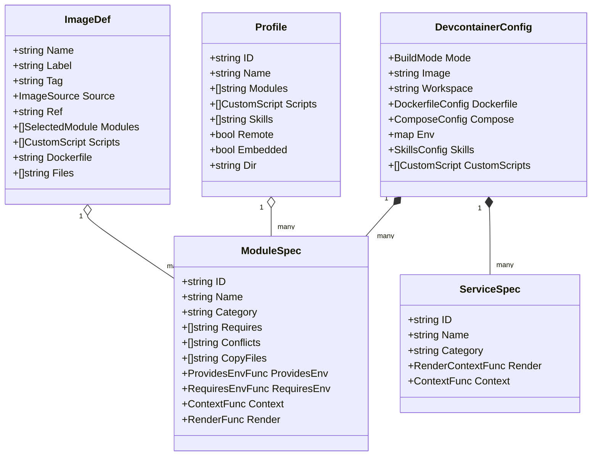
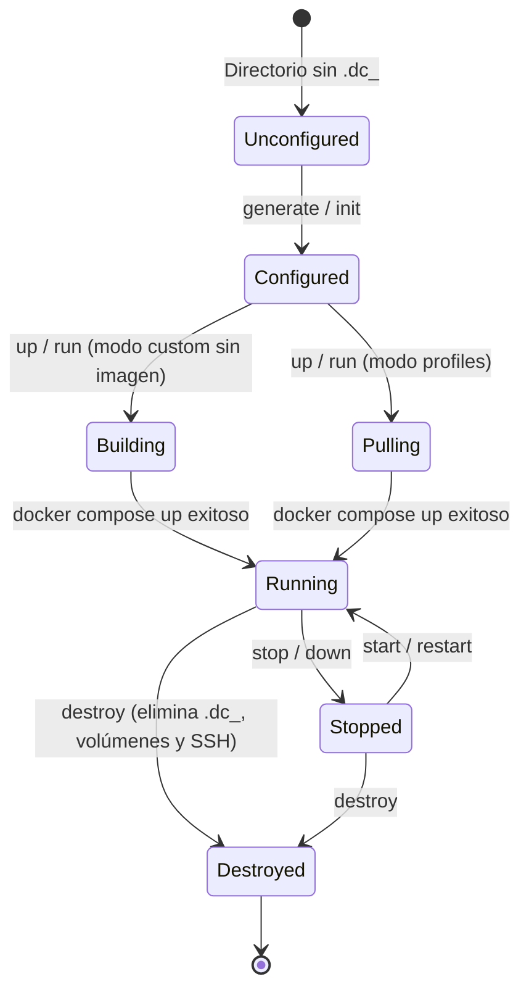

# Modelo del Dominio y Catálogo

Este documento describe las entidades principales, la taxonomía de módulos y servicios, el modelo de perfiles y la máquina de estados del ciclo de vida de los contenedores en `devcontainer-cli`.

---

## 1. Entidades Principales del Dominio

### `DevcontainerConfig`
Entidad raíz que representa la configuración completa persistida en `devcontainer.config.json` para un proyecto:
- `Mode`: estrategia de compilación (`custom`, `profiles` o `image`).
- `Image`: nombre o etiqueta de la imagen Docker final (`devcontainer-cli/<fp12>:latest`, imagen remota de GHCR, o imagen nombrada `devcontainer-cli-img/<name>:<tag>`).
- `Workspace`: identificador limpio del espacio de trabajo derivado del nombre del directorio del proyecto.
- `Dockerfile.Modules`: lista ordenada de identificadores de módulos Dockerfile activados.
- `Compose.Services`: lista de identificadores de servicios Compose complementarios (bases de datos, motores).
- `Compose.Subnet`: subred IPv4 asignada para la red privada del stack (por defecto `172.25.0.0/28`).
- `Env`: mapa clave-valor de variables requeridas por los módulos y servicios.
- `Skills`: configuración de habilidades de agente seleccionadas y modo de instalación (`manual` o `auto`).
- `CustomScripts`: scripts adicionales definidos por el usuario o provistos por perfiles.

### `ImageDef`
Entidad que representa una imagen reutilizable e independiente de proyectos, persistida en `~/.config/devcontainer-cli/images/<name>/image.yml`:
- `Name`: identificador único de la imagen (`[a-z0-9][a-z0-9_-]*`).
- `Tag`: etiqueta de versión (por defecto `latest`).
- `Source`: origen de la imagen (`build` para compilación local con módulos/scripts, o `remote` para consumir un registro externo).
- `Ref`: referencia externa completa cuando `Source` es `remote` (ej. `ghcr.io/org/devcontainer:v1.0`).
- `Modules`: módulos Dockerfile integrados en la imagen base.
- `Scripts`: scripts personalizados de compilación.
- `Namespace`: las imágenes locales construidas se etiquetan bajo `devcontainer-cli-img/<name>:<tag>` para aislarlas del ciclo de vida de los proyectos.

---

## 2. Catálogo de Módulos Dockerfile (`internal/domain/catalog`)

Cada módulo implementa `dockerfile.ModuleSpec` y declara sus contratos de construcción y ejecución:

| Módulo ID | Categoría | Propósito e Invariantes |
|---|---|---|
| `base` | Base | Requerido y siempre activo. Ubuntu 24.04, usuario `devuser` (UID/GID dinámico), sudo sin contraseña, utilidades esenciales (`curl`, `git`, `zsh`, `jq`, `lsof`). |
| `aliases` | Shell | Requerido y siempre activo directamente después de `base`. Inyecta `~/.devcontainer_aliases.sh`, `kill_port`, shims de agentes y cableado de `~/.alias.sh`. |
| `nodejs` | Lenguajes | Instalación de Node.js mediante gestor de versiones (fnm/nvm). Declara `NodeCurrentLink` (`~/.node-current`) en `ProvidesEnv` para procesos sin shell. |
| `python` | Lenguajes | Python 3, `uv`, `UV_SYSTEM_PYTHON=1`, `UV_BREAK_SYSTEM_PACKAGES=1` y permisos en rutas de `sysconfig.get_path`. Prohibido `VIRTUAL_ENV` global. |
| `golang` | Lenguajes | Toolchain Go descargado y verificado en `/usr/local/go`. Añade `/usr/local/go/bin` y `~/go/bin` al `ProvidesEnv`. |
| `java-temurin` | Lenguajes | Eclipse Temurin OpenJDK (versiones seleccionables: 17, 21, etc.). Incompatible con `java-openjdk`. |
| `java-openjdk` | Lenguajes | OpenJDK estándar de distribución con `--no-install-recommends` (headless). Incompatible con `java-temurin`. |
| `bun` | Lenguajes | Runtime de JavaScript Bun instalado en `~/.bun/bin`, integrado en `ProvidesEnv`. |
| `pnpm` | Herramientas | Gestor de paquetes de Node.js. Requiere el módulo `nodejs`. |
| `yarn` | Herramientas | Gestor de paquetes clásico/moderno de Node.js. Requiere el módulo `nodejs`. |
| `sqlite` | Bases de Datos | Cliente de línea de comandos SQLite3 y librerías de desarrollo. |
| `dbclients` | Bases de Datos | Clientes de conexión de bases de datos (`psql`, `mongosh`, `redis-cli`) para interactuar con servicios Compose. |
| `github-cli` | Herramientas | CLI oficial de GitHub (`gh`) y configuración de credenciales. |
| `ai-clis` | IA | Scripts de arranque para CLIs de asistencia de IA (`claude-code`, `opencode`, `codex-cli`, `copilot-cli`, `antigravity-cli`). |
| `zellij` | Terminal | Multiplexor de terminal moderno en Rust instalado en `/usr/local/bin`. |
| `cloudflared` | Redes | Módulo de cliente Cloudflare Tunnel para accesos remotos y Zero Trust. |
| `cleanup` | Sistema | Módulo final siempre activo. Elimina cachés de apt, temporales de compilación y ajusta permisos finales. |
| `shell_init` | Sistema | Genera los enlaces de inicio de shell (`.zshrc`, `.bashrc`, `.zshenv`) asegurando la carga de variables y alias. |

---

## 3. Catálogo de Servicios Compose (`compose.ServiceSpec`)

Servicios complementarios definidos en `docker-compose.yml`:

| Servicio ID | Imagen Base | Puertos Típicos | Volúmenes y Características |
|---|---|---|---|
| `devcontainer` | Construida localmente o GHCR | `2222:22` (SSH) | Montaje del workspace en `/workspaces/<ws>`, volumen compartido `devcontainer-shared-config` y red interna. |
| `postgres` | `postgres:alpine` | `5432:5432` | Volumen de datos persistente `<workspace>-postgres-data`, variables `POSTGRES_USER` y `POSTGRES_PASSWORD`. |
| `redis` | `redis:alpine` | `6379:6379` | Cache en memoria con persistencia en `<workspace>-redis-data`. |
| `mongo` | `mongo:latest` | `27017:27017` | Base de datos NoSQL con volumen persistente `<workspace>-mongo-data`. |
| `dind_engine` | `docker:dind` | Interno | Motor de Docker secundario para escenarios avanzados de Docker-in-Docker sin exponer el socket del host. |

---

## 4. Perfiles y Temporización de Scripts (`CustomScript.When`)

Un perfil agrupa módulos, configuraciones de puertos y scripts personalizados. Los scripts se ejecutan en momentos precisos según su propiedad `When`:

| Momento (`when`) | Destino en Contenedor | Mecanismo de Ejecución |
|---|---|---|
| `build` | `/tmp/devcontainer-custom-scripts/` | Capa `RUN` en el Dockerfile como `devuser`. El directorio temporal se borra en la misma capa. |
| `start` | `~/post-script/start.d/90-<script>.sh` | Ejecutado por `entrypoint.sh` en orden lexicográfico una sola vez por vida de contenedor (protegido por archivo centinela `.done`). |
| `service` | `~/post-script/services.d/<script>.sh` | Ejecutado en segundo plano por `entrypoint.sh` en cada arranque del contenedor (sin centinela `.done`). |
| `manual` | `~/post-script/<script>.sh` | No se ejecuta automáticamente; queda disponible para ejecución manual por parte del usuario. |

---

## 5. Máquina de Estados del Ciclo de Vida

1. **Unconfigured**: No existe `.dc_<workspace>/`.
2. **Configured**: `devcontainer.config.json`, `docker-compose.yml` y `Dockerfile` han sido generados.
3. **Building / Pulling**: Resolución de imagen según modo (`custom` calcula huella digital SHA-256; `profiles` verifica variante remota).
4. **Running**: El contenedor `devcontainer-ssh` se encuentra activo, el entrypoint completó sus etapas y el daemon OpenSSH escucha en el puerto 2222.
5. **Stopped**: Contenedores detenidos conservando volúmenes y configuración.
6. **Destroyed**: Eliminación total de contenedores, redes, volúmenes de datos, archivos en `.dc_<workspace>/` y desasociación de claves SSH y entradas en `known_hosts`.
