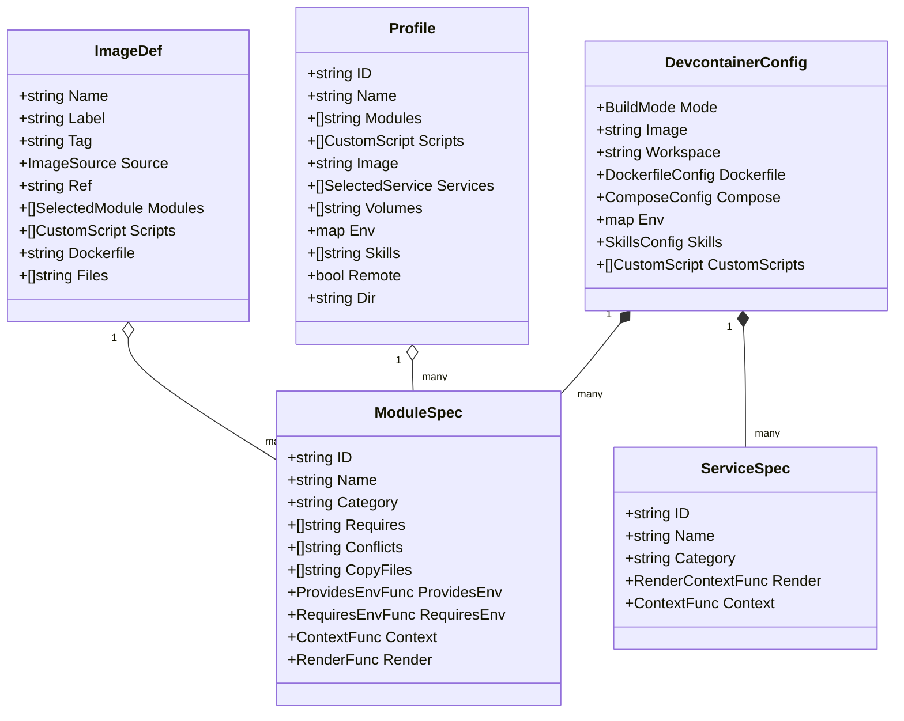
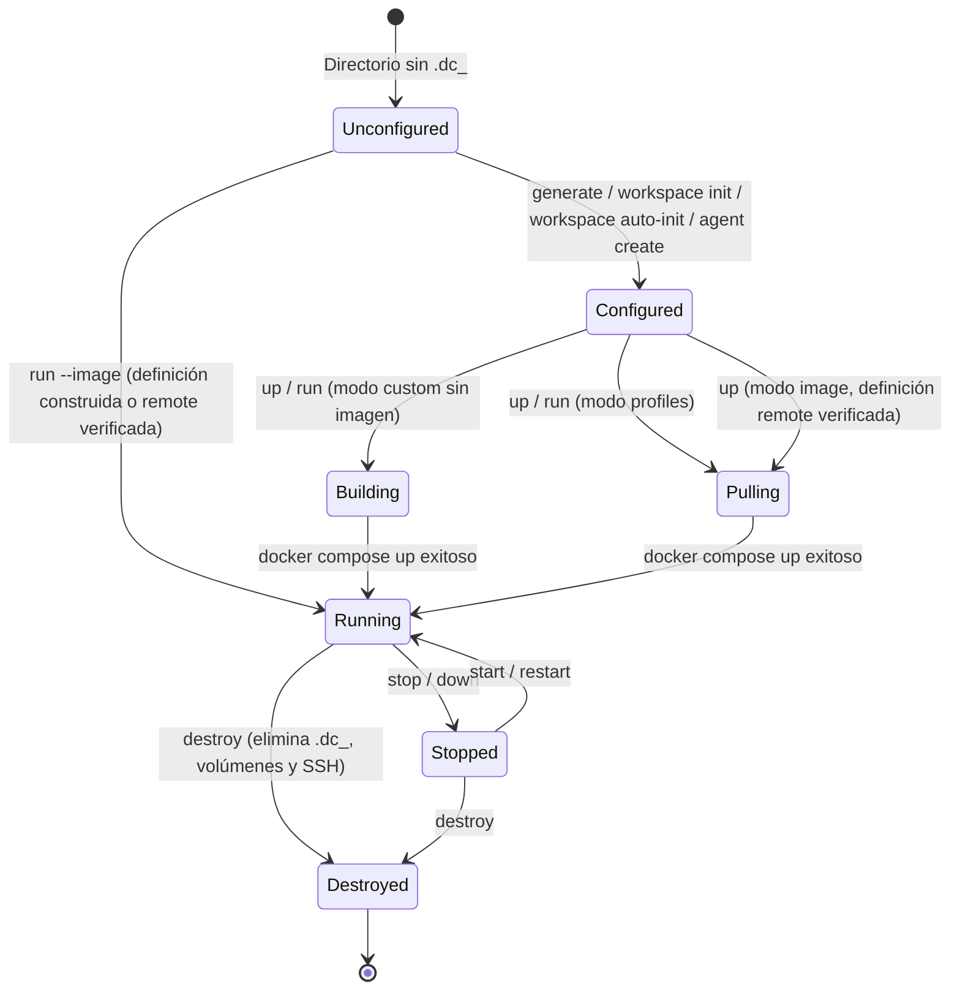

# Modelo del Dominio y Catálogo

Este documento describe las entidades principales, la taxonomía de módulos y servicios, el modelo de perfiles y la máquina de estados del ciclo de vida de los contenedores en `devcontainer-cli`.

---

## 1. Entidades Principales del Dominio

### `DevcontainerConfig`
Entidad raíz que representa la configuración completa persistida en `devcontainer.config.json` para un proyecto:
- `Mode`: estrategia de compilación (`custom`, `profiles` o `image`).
- `Image`: nombre o etiqueta de la imagen Docker final (`devcontainer-cli/<origen>-<fp8>:latest`, imagen remota de GHCR, o imagen nombrada `devcontainer-cli-img/<name>:<tag>`).
- `Workspace`: identificador limpio del espacio de trabajo derivado del nombre del directorio del proyecto.
- `Dockerfile.Modules`: lista ordenada de identificadores de módulos Dockerfile activados.
- `Compose.Services`: lista de identificadores de servicios Compose complementarios (bases de datos, motores).
- `Compose.Subnet`: subred IPv4 asignada para la red privada del stack (por defecto `172.25.0.0/28`).
- `Env`: mapa clave-valor de variables requeridas por los módulos y servicios.
- `Skills`: configuración de habilidades de agente seleccionadas y modo de instalación (`manual` o `auto`).
- `CustomScripts`: scripts adicionales definidos por el usuario o provistos por perfiles.

### `ImageDef`
Entidad que representa una imagen reutilizable e independiente de proyectos, persistida en `~/.config/devcontainer-cli/images/<name>/image.yml`:
- `Name`: identificador único de la imagen (`[a-z0-9][a-z0-9_-]*`).
- `Tag`: etiqueta de versión (por defecto `latest`).
- `Source`: origen de la imagen (`build` para compilación local con módulos/scripts, o `remote` para consumir un registro externo).
- `Ref`: referencia externa completa cuando `Source` es `remote` (ej. `ghcr.io/org/devcontainer:v1.0`).
- `Modules`: módulos Dockerfile integrados en la imagen base.
- `Scripts`: scripts personalizados de compilación.
- `Namespace`: las imágenes locales construidas se etiquetan bajo `devcontainer-cli-img/<name>:<tag>` para aislarlas del ciclo de vida de los proyectos.

### `UserSkillManifest` y `DiscoveredSkill`
Entidades asociadas a habilidades de asistente definidas por el usuario (`~/.config/devcontainer-cli/skills/<id>.yml`):
- `UserSkillManifest`: manifiesto en formato YAML que especifica identificador normalizado (`ID`), etiqueta descriptiva (`Label`), origen Git o URL (`Ref`), selector secundario opcional (`Skill`), módulos requeridos (`RequiresModules`) y directiva de orientación contextual para `~/CONTEXT.md` (`Context.Title`, `Context.Body`).
- `DiscoveredSkill`: representación en memoria obtenida durante el proceso de descubrimiento (`npx skills add <source> --copy -y --json` en directorio temporal). Almacena auditoría de seguridad provista por Snyk (`Snyk`), estado de instalación (`Status`), descripción extraída del frontmatter YAML de `SKILL.md` y manifiesto preparado para su persistencia.

---

## 2. Catálogo de Módulos Dockerfile (`internal/domain/catalog`)

Cada módulo implementa `dockerfile.ModuleSpec` y declara sus contratos de construcción y ejecución:

| Módulo ID | Categoría | Propósito e Invariantes |
|---|---|---|
| `base` | Base | Requerido y siempre activo. Ubuntu 24.04, usuario `devuser` (UID/GID dinámico), sudo sin contraseña, utilidades esenciales (`curl`, `git`, `zsh`, `jq`, `lsof`). |
| `aliases` | Shell | Requerido y siempre activo directamente después de `base`. Inyecta `~/.devcontainer_aliases.sh`, `kill_port`, shims de agentes y cableado de `~/.alias.sh`. |
| `nodejs` | Lenguajes | Instalación de Node.js mediante gestor de versiones (fnm/nvm). Declara `NodeCurrentLink` (`~/.node-current`) en `ProvidesEnv` para procesos sin shell. |
| `python` | Lenguajes | Python 3, `uv`, `UV_SYSTEM_PYTHON=1`, `UV_BREAK_SYSTEM_PACKAGES=1` y permisos en rutas de `sysconfig.get_path`. Prohibido `VIRTUAL_ENV` global. |
| `golang` | Lenguajes | Toolchain Go descargado y verificado en `/usr/local/go`. Añade `/usr/local/go/bin` y `~/go/bin` al `ProvidesEnv`. |
| `java-temurin` | Lenguajes | Eclipse Temurin OpenJDK (versiones seleccionables: 17, 21, etc.). Incompatible con `java-openjdk`. |
| `java-openjdk` | Lenguajes | OpenJDK estándar de distribución con `--no-install-recommends` (headless). Incompatible con `java-temurin`. |
| `android-sdk` | Herramientas de desarrollo | Android SDK en `/opt/android-sdk` (`ANDROID_HOME`): cmdline-tools fijados, platform-tools (`adb`, `fastboot`), plataforma y build-tools del nivel de API elegido (34 o 35). Requiere `java-temurin` y se renderiza después del JDK. Sin emulador: los dispositivos se alcanzan con `adb connect`. |
| `bun` | Lenguajes | Runtime de JavaScript Bun instalado en `~/.bun/bin`, integrado en `ProvidesEnv`. |
| `pnpm` | Herramientas | Gestor de paquetes de Node.js. Requiere el módulo `nodejs`. |
| `yarn` | Herramientas | Gestor de paquetes clásico/moderno de Node.js. Requiere el módulo `nodejs`. |
| `sqlite` | Bases de Datos | Cliente de línea de comandos SQLite3 y librerías de desarrollo. |
| `dbclients` | Bases de Datos | Clientes de conexión de bases de datos (`psql`, `mongosh`, `redis-cli`) para interactuar con servicios Compose. |
| `github-cli` | Herramientas | CLI oficial de GitHub (`gh`) y configuración de credenciales. |
| `ai-clis` | IA | Scripts de arranque para CLIs de asistencia de IA (`claude-code`, `opencode`, `codex-cli`, `copilot-cli`, `antigravity-cli`, `herdr`). |
| `zellij` | Terminal | Multiplexor de terminal moderno en Rust instalado en `/usr/local/bin`. |
| `cloudflared` | Redes | Módulo de cliente Cloudflare Tunnel para accesos remotos y Zero Trust. |
| `cleanup` | Sistema | Módulo final siempre activo. Elimina cachés de apt, temporales de compilación y ajusta permisos finales. |
| `shell_init` | Sistema | Genera los enlaces de inicio de shell (`.zshrc`, `.bashrc`, `.zshenv`) asegurando la carga de variables y alias. |

---

## 3. Catálogo de Servicios Compose (`compose.ServiceSpec`)

Servicios complementarios definidos en `docker-compose.yml`:

| Servicio ID | Imagen Base | Puertos Típicos | Volúmenes y Características |
|---|---|---|---|
| `devcontainer` | Construida localmente o GHCR | `2222:22` (SSH) | Montaje del workspace en `/workspaces/<ws>`, volumen compartido `devcontainer-shared-config` y red interna. |
| `postgres` | `postgres:alpine` | `5432:5432` | Volumen de datos persistente `<workspace>-postgres-data`, variables `POSTGRES_USER` y `POSTGRES_PASSWORD`. |
| `redis` | `redis:alpine` | `6379:6379` | Cache en memoria con persistencia en `<workspace>-redis-data`. |
| `mongo` | `mongo:latest` | `27017:27017` | Base de datos NoSQL con volumen persistente `<workspace>-mongo-data`. |
| `dind_engine` | `docker:dind` | Interno | Motor de Docker secundario para escenarios avanzados de Docker-in-Docker sin exponer el socket del host. |

---

## 4. Perfiles y Temporización de Scripts (`CustomScript.When`)

Un perfil es una plantilla de proyecto: agrupa módulos, una imagen de partida opcional (`image`), scripts personalizados, servicios compose, volúmenes, variables de entorno, puertos y habilidades, con el mismo significado que en `devcontainer.config.json`. El valor de `image` es el nombre de una definición de imagen o una referencia de registro de una imagen construida por la CLI. Un perfil con solo `image` deja el proyecto en `mode=image`; con `image` y `modules` el proyecto se construye derivado de esa imagen (ver D22).

### Imágenes Derivadas (`from`)

Una definición de imagen (`images/<name>/image.yml`) o un proyecto (`dockerfile.from` en `devcontainer.config.json`) puede partir de otra imagen en lugar de `ubuntu`:

- **Linaje**: si `from` es una definición, sus módulos se leen de las propias definiciones siguiendo su cadena `from` (los ciclos son un error); si es una referencia de registro, se leen de su etiqueta `dev.devcontainer-installer.modules`. Una imagen sin esa etiqueta no puede usarse como base.
- **Generación**: el Dockerfile comienza con `FROM <padre>`, reasigna el UID/GID de `devuser` si difieren de los del anfitrión, renderiza solo los módulos que el padre no tiene (más `cleanup`, que siempre se vuelve a renderizar) y emite el entorno completo (`ENV` y `~/.dc-env.sh`) de todo el linaje.
- **Etiqueta de módulos**: lista el linaje completo, de modo que una imagen derivada puede a su vez ser padre.
- **Disponibilidad del padre**: un padre definido debe estar construido (`image build <padre>`); una referencia de registro se descarga si falta. En ambos casos debe cumplir el contrato de imagen (D17).
- **Huella**: en proyectos derivados, el ID del contenido del padre alimenta la huella, por lo que reconstruir el padre con la misma etiqueta genera una nueva imagen de proyecto. La CLI incluye 12 perfiles planos integrados (`base`, `nodejs`, `bun`, `java-temurin`, `python`, `go`, `node-go`, `node-python`, `node-java-temurin`, `bun-go`, `bun-python`, `bun-java-temurin`), y permite a los usuarios definir perfiles propios en `~/.config/devcontainer-cli/profiles/<id>/` (siempre como directorio `<id>/profile.yml` acompañado de sus scripts `.sh`; los archivos planos `<id>.yml` y el directorio heredado `presets/` ya no se leen). Los perfiles, las definiciones de imagen y las habilidades de usuario se versionan juntos en el repositorio de configuración (ver D19).

Los scripts personalizados definidos por el usuario o provistos en sus perfiles se ejecutan en momentos precisos según su propiedad `When`:

| Momento (`when`) | Destino en Contenedor | Mecanismo de Ejecución |
|---|---|---|
| `build` | `/tmp/devcontainer-custom-scripts/` | Capa `RUN` en el Dockerfile como `devuser`. El directorio temporal se borra en la misma capa. |
| `start` | `~/post-script/start.d/90-<script>.sh` | Ejecutado por `entrypoint.sh` en orden lexicográfico una sola vez por vida de contenedor (protegido por archivo centinela `.done`). |
| `service` | `~/post-script/services.d/<script>.sh` | Ejecutado en segundo plano por `entrypoint.sh` en cada arranque del contenedor (sin centinela `.done`). |
| `manual` | `~/post-script/<script>.sh` | No se ejecuta automáticamente; queda disponible para ejecución manual por parte del usuario. |

**Contrato de entorno de scripts (D25)**: como `su -` arranca con un entorno vacío, el entrypoint antepone a los bloques de `start` y `service` las variables `DC_WORKSPACE_DIR` (directorio del proyecto, `/workspaces/<workspace>`), `DC_WORKSPACE` (su nombre) y `DC_SCRIPT_PHASE` (`start` o `service`); si no hay proyecto montado, la ruta y el nombre quedan vacíos. Un script `build` recibe solo `DC_SCRIPT_PHASE=build`, porque durante `docker build` no hay proyecto montado. Un script `manual` se ejecuta en la shell del usuario y no recibe ninguna. `domain.LintCustomScript` emite una advertencia (nunca un error) cuando un script `build` menciona `/workspaces` o `/workspace` (no bajo `$HOME`), `$WORKSPACE` o `$DC_WORKSPACE*` fuera de un comentario, en un solo aviso por script con todas las líneas; `MaterializeCustomScripts` la muestra antes de cada construcción de proyecto o de imagen.

### Composición de Múltiples Perfiles (`--profile a,b`)

En `mode=custom`, la bandera `--profile` acepta una lista de identificadores separados por comas que se fusionan en un único perfil efectivo antes de compilar la imagen local:

- **Unión de Módulos**: Se combinan los módulos de todos los perfiles preservando el orden de primera aparición y eliminando duplicados. Los conflictos entre módulos incompatibles (ej. `java-temurin` y `java-openjdk`) son detectados por el resolver del catálogo.
- **Concatenación de Scripts**: Los scripts personalizados se concatenan en el orden especificado. Si dos perfiles declaran scripts con el mismo nombre de archivo de destino en el directorio de construcción (`custom-<archivo>.sh`), el comando falla inmediatamente nombrando a ambos perfiles en conflicto.
- **Unión de Habilidades, Puertos, Volúmenes y Servicios**: Las habilidades de agente (`skills`), puertos publicados (`ports`), túneles SSH (`forward_ports`), volúmenes (`volumes`) y servicios (`services`, por id; prevalecen las opciones del primer perfil) se combinan mediante unión deduplicada en orden de primera aparición.
- **Fusión de Entorno e Imagen**: Las variables `env` se fusionan; si dos perfiles asignan valores distintos a la misma variable, o declaran imágenes de partida distintas, la generación se rechaza con error explícito.
- **Validación de Modo de Habilidades**: Si dos o más perfiles especifican modos explícitos de instalación (`skills_mode`) que entren en contradicción (por ejemplo, `manual` y `auto`), la generación se rechaza con error explícito.
- **Invariante de Perfil Único para Descarga Remota**: `mode=profiles` y `devcontainer-cli run --profile` únicamente admiten un único perfil remoto publicado (`[remote]`). Si se pasa una lista separada por comas a estos comandos, se genera un error descriptivo no interactivo. `run` también acepta `--image <definición>` en lugar de `--profile` (son excluyentes, ver D27).

---

## 5. Máquina de Estados del Ciclo de Vida

1. **Unconfigured**: No existe `.dc_<workspace>/`.
2. **Configured**: `devcontainer.config.json`, `docker-compose.yml` y `Dockerfile` han sido generados.
3. **Building / Pulling**: Resolución de imagen según modo (`custom` calcula huella digital SHA-256 y nombra la imagen por origen y contenido; `profiles` verifica variante remota). Tras compilar se recolectan las imágenes de proyecto que ya nadie referencia.
4. **Running**: El contenedor `devcontainer-ssh` se encuentra activo, el entrypoint completó sus etapas y el daemon OpenSSH escucha en el puerto 2222.
5. **Stopped**: Contenedores detenidos conservando volúmenes y configuración.
6. **Destroyed**: Eliminación total de contenedores, redes, volúmenes de datos, archivos en `.dc_<workspace>/` y desasociación de claves SSH y entradas en `known_hosts`. La imagen del proyecto se elimina si ningún otro proyecto la comparte.
