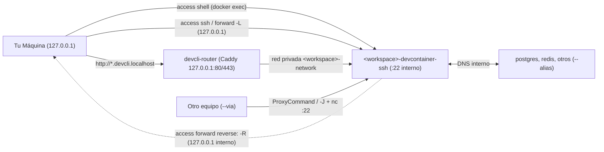

# Red, SSH y Conectividad del Contenedor

Por diseño, ningún entorno de `devcontainer-cli` publica puertos al exterior ni en `0.0.0.0` al arrancar: cada proyecto corre aislado en su propia red privada Docker y **toda exposición o túnel apunta por defecto a `127.0.0.1` (`localhost`)**.

> - Flags completos de cada subcomando: ejecuta `devcontainer-cli access <subcomando> --help` o consulta [`.docs/cli-reference.md`](.docs/cli-reference.md).
> - Decisiones técnicas e invariantes internos: [`.docs/architecture.md`](.docs/architecture.md) (`D13` y `D28`).
> - Acceso fuera de tu red local (Zero Trust): [`.docs/cloudflare-tunnel.md`](.docs/cloudflare-tunnel.md).

---

## 1. Por qué todo va a `127.0.0.1` por defecto

1. **Red privada `/28` sin puertos publicados al inicio**: al crear el proyecto se levanta `<workspace>-network` en una subred privada (`/28`) sin puertos expuestos en `compose.yml` (tampoco el puerto `22` interno de OpenSSH). Así varios proyectos con Postgres en `:5432` o apps en `:3000` nunca chocan entre sí ni se exponen a tu red local. Dentro de esa red los servicios se llaman por nombre (`postgres:5432`, `redis:6379`).
2. **Publicación con `--ports` prefijada con `127.0.0.1:`**: si pasas `--ports 8080:80`, la CLI fuerza `127.0.0.1:8080:80` en lugar del `0.0.0.0` habitual de Docker (salvo que indiques otra IP de forma explícita, como tu IP de VPN/Tailscale).
3. **`access forward` (`-L`) siempre en `127.0.0.1` por defecto**: un túnel directo escucha en `127.0.0.1` (para tu máquina y con *Secure Context* válido en el navegador) sin editar `compose.yml` ni reiniciar el stack. Si indicas una IP inicial (`100.x.y.z:8000:8000`) o `--service postgres`, ajustas origen o servicio destino al vuelo.
4. **`access forward reverse:<puerto>` (`-R`) confinado al `localhost` del contenedor**: permite que el devcontainer consuma un servicio que corre en tu host (por ejemplo una DB o Ollama local) escuchando en el loopback `127.0.0.1` interno del contenedor (no en otros contenedores de la red). Por permisos de `devuser`, el puerto del contenedor debe ser `>= 1024`.
5. **`access route` con Caddy en `127.0.0.1:80/443`**: cuando trabajas con varias apps web HTTP en paralelo y no quieres recordar en qué puerto quedó cada proyecto, `access route add <puerto>` publica `<workspace>-<puerto>.devcli.localhost` a través del proxy compartido `devcli-router` (`127.0.0.1:80/443`) sin tocar `/etc/hosts`.

---

## 2. ¿Qué comando usar en cada caso?

| Necesidad | Comando | Nota clave |
| :--- | :--- | :--- |
| Abrir terminal o comando rápido local | `devcontainer-cli access shell` | Usa `docker exec`; para scripts/agentes usa `agent exec -w -- <cmd>` (corre como `devuser`) |
| Conectar VS Code, Cursor o `ssh <workspace>` | `devcontainer-cli access ssh` | Registra bloque `Host` aislado en `~/.ssh/devcontainer-cli.config` (`--setup` solo configura) |
| SSH puntual sin modificar `~/.ssh/` | `devcontainer-cli access ssh --ephemeral` | Predeterminado en `agent ssh`; cero archivos escritos en `~/.ssh/` |
| Exponer un puerto (app o DB) en `127.0.0.1` | `devcontainer-cli access forward <spec>` | Corre en primer plano hasta `Ctrl+C` (ej. `5432 --service postgres`) |
| Consumir dentro del contenedor un puerto del host | `devcontainer-cli access forward reverse:<puerto>` | Expone `<host>:<puerto>` en `127.0.0.1:<puerto>` del devcontainer (`>= 1024`) |
| URL HTTP limpia por proyecto sin recordar puertos | `devcontainer-cli access route add <puerto>` | `http://<workspace>-<puerto>.devcli.localhost` en primer plano (`Ctrl+C` limpia) |
| Conectar otro contenedor Docker a este proyecto | `devcontainer-cli access network connect <ctr> --alias <dns>` | En caliente sobre `<workspace>-network` (`disconnect` para quitarlo) |
| Puerto fijo siempre publicado con el stack | `devcontainer-cli agent create --ports 3000:3000` | Persiste en `compose.yml` atado a `127.0.0.1` |

---

## 3. Cómo gestiona SSH las claves, el modo guardado y el modo efímero

- **Una sola clave compartida**: la CLI genera `~/.config/devcontainer-cli/ssh/id_devcontainer` (`ed25519`) al primer uso (o `config ssh-key --generate`; puedes apuntar a la tuya con `config ssh-key <ruta>`). Al conectar, inyecta la clave pública en `~/.ssh/authorized_keys` del contenedor; **la clave privada nunca se copia al contenedor**.
- **Modo guardado (`access ssh`)**: nunca reescribe tu `~/.ssh/config` —solo agrega `Include devcontainer-cli.config`— y aísla sus bloques `Host` en `~/.ssh/devcontainer-cli.config` junto con un `known_hosts` propio en `~/.config/devcontainer-cli/ssh/`. Al anclar cada bloque por nombre de contenedor, actualizar la imagen o cambiar de IP privada no provoca errores `REMOTE HOST IDENTIFICATION HAS CHANGED`. (`workspace destroy` y `config clean ssh` limpian entradas viejas).
- **Modo efímero (`--ephemeral`)**: garantiza igualmente que tu clave pública esté autorizada dentro del contenedor y marca directo al puerto `22` con opciones efímeras, **sin leer ni escribir nada en `~/.ssh/`** (es el valor por defecto de `agent ssh` y `agent forward`).
- **Contenedores en otro equipo de tu LAN (`--via`)**: ejecuta `devcontainer-cli config ssh-key --export usuario@servidor` en el servidor (como contiene la clave privada, trátalo como un secreto) y conéctate desde tu portátil con `devcontainer-cli access ssh --via usuario@servidor -c <workspace>-devcontainer-ssh`.
