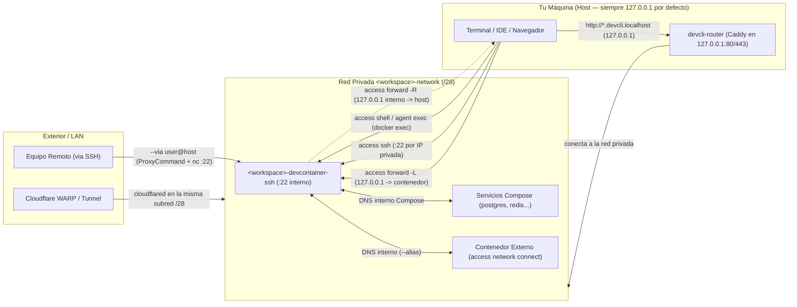

# Red, SSH y Conectividad del Contenedor

`devcontainer-cli` está diseñado bajo una regla estricta: **ningún contenedor publica puertos al exterior ni en `0.0.0.0` por defecto**, y cualquier exposición o túnel local apunta por defecto exclusivamente a **`127.0.0.1` (`localhost`)**.

Esta guía reúne toda la arquitectura de conectividad del CLI —**por qué** funciona así, cómo opera **SSH** (clave compartida, modo guardado y modo efímero), por qué existen **`forward`**, **`forward --reverse`**, **`route`** y **`network`**, y todos los subcomandos y flags de `devcontainer-cli access` y `agent`.

> Guías complementarias: [`UTILITIES.md`](UTILITIES.md) (procesos en segundo plano con Zellij) · [`MANUAL.md`](MANUAL.md) (casos de uso paso a paso) · [`.docs/cloudflare-tunnel.md`](.docs/cloudflare-tunnel.md) (acceso remoto fuera de tu LAN con Cloudflare Zero Trust y WARP).

---

## 1. Por qué todo va por defecto a `127.0.0.1` y sin puertos públicos

Si vienes de usar `docker run -p 3000:3000` o `docker-compose.yml` con bloques `ports:` abiertos, estos cuatro principios explican por qué `devcontainer-cli` trabaja distinto:

### 1.1 Red privada aislada (`/28`) y cero puertos en `compose.yml` por defecto

Al generar un proyecto, `compose.yml` crea una red bridge exclusiva llamada **`<workspace>-network`** sobre una subred `/28` libre elegida automáticamente (`172.25.x.y/28`, `172.26–254.0.0/28` o `10.x.0.0/28`, evitando colisionar con redes Docker existentes) y **no publica ningún puerto en el host** (ni siquiera el puerto `22` de OpenSSH dentro de `<workspace>-devcontainer-ssh`).

- **Por qué**: puedes levantar varios proyectos simultáneos con Node en `:3000` y Postgres en `:5432` sin colisiones entre ellos ni exposición accidental a la red Wi-Fi / LAN. Dentro de `<workspace>-network`, el devcontainer y los servicios acompañantes (`postgres`, `redis`, `mongo`, etc.) se comunican directamente por DNS interno de Docker (`postgres:5432`, `redis:6379`).

### 1.2 Por qué toda publicación y túnel apunta a `127.0.0.1` (`localhost`)

Cada mecanismo que cruza el límite entre el host y el contenedor fuerza `127.0.0.1` de forma explícita por seguridad, aislamiento y compatibilidad con navegadores:

1. **En `--ports` (`create` / `run`)**: Docker por defecto convierte `-p 8080:80` en `0.0.0.0:8080`, abriéndolo a toda tu LAN. `devcontainer-cli` intercepta cualquier especificación sin IP explícita y le antepone **`127.0.0.1:`** (`127.0.0.1:8080:80`, o `127.0.0.1::80`). Solo abre otra interfaz si escribes la IP explícitamente (por ejemplo `100.x.y.z:8080:80` para tu red Tailscale).
2. **En `access forward` / `agent forward` (túnel directo `-L`)**: siempre construye `ssh -N -L 127.0.0.1:<local>:<destino>:<contenedor>`. Incluso fija `127.0.0.1` en lugar de dejar vacía la dirección de escucha porque en OpenSSH omitirla hace que escuche tanto en `127.0.0.1` como en `::1` (IPv6). Un túnel SSH es para tu máquina local, salvo que indiques `BIND:<spec>`. Además, los navegadores tratan `127.0.0.1` y `localhost` como **Secure Context**, permitiendo `crypto.randomUUID()`, WebCrypto y Service Workers sin HTTPS.
3. **En `access forward --reverse` / `reverse:<spec>` (túnel inverso `-R`)**: siempre construye `ssh -N -R 127.0.0.1:<puerto_contenedor>:<destino_host>:<puerto_host>` y **rechaza `BIND:`**. Dentro del contenedor, `sshd` corre con `GatewayPorts=no`, lo que confina el puerto reverso al loopback interno (`127.0.0.1`) del devcontainer.
   - **Por qué**: en `<workspace>-network` pueden convivir otros servicios o contenedores externos conectados con `access network`. Confinar el túnel reverso a `127.0.0.1` dentro del devcontainer garantiza que un servicio local de tu host (por ejemplo una DB o un servidor LLM en tu máquina) sea alcanzable **solo desde dentro del devcontainer**, y no desde otros contenedores de la red.
   - **Límite importante**: como `sshd` abre el socket reverso como `devuser` (sin privilegios de `root`), los puertos reversos `< 1024` dentro del contenedor generan advertencia y fallan al hacer bind; usa puertos `>= 1024` en el contenedor. Tampoco admite `--service` porque los servicios Compose viven dentro de la red del contenedor, no en tu host.
4. **En `access route` (`devcli-router` con Caddy)**: el contenedor proxy global `devcli-router` (`caddy:alpine`) publica sus puertos exclusivamente en **`127.0.0.1:80`**, **`127.0.0.1:443`** y la API de administración en **`127.0.0.1:2019`** (orígenes aceptados: solo `127.0.0.1:2019` y `localhost:2019`). Nunca queda expuesto a la red externa.

### 1.3 Por qué existen `route`, `forward` y `network` como comandos separados

- **`access forward`** transporta **cualquier protocolo TCP** (Postgres, Redis, gRPC, o una app web) sobre una sesión SSH sin tener que editar `compose.yml` ni recrear contenedores. Incluso usa al devcontainer como puente hacia otro servicio del stack (`5432 --service postgres` o `5432:postgres:5432`).
- **`access route`** resuelve el problema de **trabajar con varias apps web HTTP en paralelo sin pelearte por puertos locales**. `devcli-router` se conecta dinámicamente a `<workspace>-network` y enruta por cabecera HTTP `Host` usando dominios **`<workspace>-<puerto>.devcli.localhost`**. Como los navegadores y sistemas resuelven `*.localhost` a `127.0.0.1` de forma nativa, obtienes URLs limpias **sin tocar `/etc/hosts`** y sin colisiones aunque tres proyectos corran Vite en `:5173`.
- **`access network`** conecta **otros contenedores Docker independientes** (otro `compose.yml` en tu máquina) a `<workspace>-network` en caliente, evitando tener que publicar sus puertos en el host para que el devcontainer pueda llamarlos.



---

## 2. Mapa de Decisión Rápida

| Escenario | Comando recomendado | Mecanismo subyacente | Alcance / Persistencia |
| :--- | :--- | :--- | :--- |
| Correr comando puntual o abrir terminal rápida | `access shell` / `agent exec -w -- <cmd>` | `docker exec` (o SSH al host con `--via`) | Inmediato; no necesita `sshd` dentro del contenedor |
| Conectar VS Code / Cursor o terminal SSH diaria | `access ssh` (o `--setup`) | OpenSSH al puerto `:22` interno | Guarda alias en `~/.ssh/devcontainer-cli.config` |
| Conexión SSH desde scripts / agentes sin ensuciar `~/.ssh` | `access ssh --ephemeral` / `agent ssh` | OpenSSH directo (`UserKnownHostsFile=/dev/null`) | Sin escritura en `~/.ssh/` del host |
| Abrir DB, Redis, API o app puntual en `127.0.0.1` | `access forward` / `agent forward` | Túnel SSH `-L` (en primer plano hasta `Ctrl+C`) | Bajo demanda, sin tocar `compose.yml` |
| Dar acceso desde el contenedor a un servicio de tu host | `access forward reverse:<puerto>` | Túnel SSH `-R` en `127.0.0.1` del contenedor | Solo visible dentro del devcontainer (`GatewayPorts=no`) |
| Abrir apps HTTP locales con URL por proyecto | `access route add <puerto>` | Caddy global `devcli-router` (`*.devcli.localhost`) | En primer plano; `Ctrl+C` desregistra la ruta |
| Comunicar otro contenedor Docker con este proyecto | `access network connect <cont>` | `docker network connect` a `<workspace>-network` | En caliente, con `--alias` DNS opcional |
| Publicar un puerto fijo mientras el stack esté arriba | `create` / `agent create --ports ...` | `ports:` en `compose.yml` (prefijado con `127.0.0.1:`) | Permanente mientras el stack esté arriba |
| Acceder desde fuera de tu red local | Servicio `cloudflared` | Túnel Cloudflare Zero Trust hacia la subred `/28` | Ver [`.docs/cloudflare-tunnel.md`](.docs/cloudflare-tunnel.md) |

---

## 3. Arquitectura SSH: Clave Compartida, Modo Guardado y Modo Efímero

### 3.1 La clave SSH compartida (`id_devcontainer`)

En lugar de crear una clave por cada proyecto, `devcontainer-cli` utiliza **una única clave SSH compartida** reutilizada en todos tus contenedores (locales y remotos):

- **Ruta por defecto**: `~/.config/devcontainer-cli/ssh/id_devcontainer` (y su clave pública `.pub`).
- **Algoritmo**: `ed25519` sin frase de paso (`ssh-keygen -t ed25519`).
- **Creación automática**: se genera la primera vez que ejecutas `access ssh` (incluso con `--ephemeral` o `agent ssh`), o manualmente con:
  ```bash
  devcontainer-cli config ssh-key --generate
  ```

#### Usar tu propia clave y precedencia

Si ya utilizas una clave personal (por ejemplo `~/.ssh/id_ed25519`), puedes registrarla como predeterminada en `~/.config/devcontainer-cli/config.json`:

```bash
devcontainer-cli config ssh-key                      # Ver la ruta actual y si existe
devcontainer-cli config ssh-key ~/.ssh/id_ed25519    # Usar tu propia clave por defecto
devcontainer-cli config ssh-key --unset              # Volver a ~/.config/devcontainer-cli/ssh/id_devcontainer
```

Al conectar, la clave se resuelve en este orden de precedencia:
1. Flag explícito `--key <ruta>`.
2. Clave configurada con `config ssh-key` (`defaults.sshKeyPath`).
3. Clave compartida gestionada (`~/.config/devcontainer-cli/ssh/id_devcontainer`).

#### Cómo se autoriza dentro del contenedor

Cada vez que preparas SSH (tanto en modo guardado como en `--ephemeral`), la CLI inyecta la clave pública por `docker exec -i` en `~/.ssh/authorized_keys` del usuario objetivo (`devuser` por defecto):
- Resuelve el `$HOME` real del usuario mediante `getent passwd` (clave cuando el entrypoint remapea el UID/GID de `devuser`).
- Añade la clave pública de forma idempotente (`sort -u` para no duplicarla) y fija permisos estrictos (`700` en `~/.ssh`, `600` en `authorized_keys`).

> La clave privada **nunca** se copia dentro del contenedor.

#### Exportar acceso hacia un servidor remoto (`--export`)

Si tus contenedores corren en otro equipo (por ejemplo un servidor en tu LAN) y quieres operar desde tu portátil sin copiar archivos manualmente, ejecuta en el servidor:

```bash
devcontainer-cli config ssh-key --export usuario@servidor
```

Imprime un bloque autocontenido que prepara la clave gestionada y el `ProxyCommand` en la máquina cliente. Como contiene la clave privada, trátalo como un secreto.

---

### 3.2 Modo Guardado / Persistente (`devcontainer-cli access ssh`)

Pensado para que `ssh <workspace>` y **VS Code Remote - SSH / Cursor / JetBrains Gateway** funcionen de inmediato sin contaminar tu `~/.ssh/config` ni mostrar alertas cuando reconstruyes una imagen.

#### Archivos que administra en el host

1. **`~/.ssh/devcontainer-cli.config`** *(personalizable con `devcontainer-cli config ssh-config-file <ruta>`)*:
   Aquí escribe la CLI todos sus bloques `Host <alias>`, cada uno precedido por un marcador estructurado:
   ```text
   # devcontainer-cli:managed v=1 kind=workspace ref=mi-proyecto alias=mi-proyecto
   Host mi-proyecto
       HostName 172.25.0.14
       User devuser
       IdentityFile /home/tu-usuario/.config/devcontainer-cli/ssh/id_devcontainer
       IdentitiesOnly yes
       UserKnownHostsFile /home/tu-usuario/.config/devcontainer-cli/ssh/known_hosts
       StrictHostKeyChecking accept-new
       HashKnownHosts no
   ```
2. **`~/.ssh/config`**:
   La CLI **nunca reescribe tu `~/.ssh/config`**. Únicamente añade una línea al principio:
   ```text
   Include devcontainer-cli.config
   ```
   *(Si detecta bloques antiguos escritos por versiones previas en `~/.ssh/config`, los migra automáticamente a `devcontainer-cli.config`.)*
3. **`~/.config/devcontainer-cli/ssh/known_hosts`**:
   Archivo `known_hosts` propio y aislado del `~/.ssh/known_hosts` del usuario.

#### Por qué un `known_hosts` propio (*Host-Key Pinning*) y anclaje por nombre

- Cuando reconstruyes la imagen Docker, el nuevo contenedor regenera su clave de host SSH mientras casi siempre recibe la misma IP interna (por ejemplo `172.25.0.14`). Si esas claves vivieran en tu `~/.ssh/known_hosts`, OpenSSH abortaría con `REMOTE HOST IDENTIFICATION HAS CHANGED`. Al aislarlas en `~/.config/devcontainer-cli/ssh/known_hosts` con `HashKnownHosts no`, la CLI lee la clave pública real del contenedor vía Docker y la **re-fija automáticamente** antes de conectar.
- El bloque guardado identifica el objetivo por **nombre de contenedor** (`<workspace>-devcontainer-ssh` o el pasado con `--container`): si el contenedor cambia de IP privada al recrearse, `access ssh` actualiza el `HostName` automáticamente; si el contenedor fue destruido, falla de inmediato avisando que el alias está obsoleto en lugar de colgarse en un timeout.

#### Modo remoto guardado (`--via`) y limpieza

```bash
devcontainer-cli access ssh --via usuario@servidor --container mi-proyecto-devcontainer-ssh
```

Guarda un bloque `Host` con `ProxyCommand ssh usuario@servidor "nc -q0 $(docker inspect ...) 22"`, resolviendo la IP privada del contenedor en vivo dentro del servidor remoto al conectar. Solo necesitas pasar `--via` la primera vez: las siguientes llamadas con `access ssh --container ...` o `ssh <alias>` recuerdan el salto y re-fijan la clave bajo el alias.

Para limpiar entradas viejas:
- `devcontainer-cli workspace destroy` borra el bloque `Host` y las claves fijadas del proyecto.
- `devcontainer-cli config clean ssh` detecta y limpia entradas huérfanas de contenedores o proyectos eliminados (incluidas las creadas con `--via` si el servidor remoto es accesible).

---

### 3.3 Modo Efímero (`--ephemeral`)

```bash
devcontainer-cli access ssh --ephemeral
devcontainer-cli access ssh --ephemeral --via usuario@servidor -c mi-proyecto-devcontainer-ssh
```

Es además el comportamiento **predeterminado** de `devcontainer-cli agent ssh` y `devcontainer-cli agent forward` (se puede desactivar pasando `--ephemeral=false` donde esté disponible).

#### Qué hace exactamente

1. **Cero escritura en `~/.ssh/`**: no lee ni modifica `~/.ssh/config`, `~/.ssh/devcontainer-cli.config` ni ningún `known_hosts`.
2. **Garantiza la clave en el contenedor**: asegura que la clave compartida exista en el host e instala su mitad pública en `~/.ssh/authorized_keys` dentro del contenedor antes de marcar (evitando `Permission denied (publickey)` en contenedores recién creados).
3. **Resolución en vivo y marcado directo**:
   - Inspecciona la IP privada actual del contenedor en el daemon Docker (local o vía `--via`, con fallback a `127.0.0.1` si no tiene red).
   - Lanza `ssh` directo al **puerto `22`** (agregando `-J <via>` cuando se pasa `--via`) con:
     - `-i <clave>`
     - `-p 22`
     - `-o StrictHostKeyChecking=no`
     - `-o UserKnownHostsFile=/dev/null`
     - `-o LogLevel=ERROR`

**Por qué existe**: permite que **agentes de IA**, pipelines de **CI/CD** y scripts operen sobre cualquier contenedor —incluidos los temporales creados con `agent run`— sin dejar alias ni claves huérfanas en el host ni chocar con bloques `Host` existentes.

---

## 4. Todos los Subcomandos y Flags de `devcontainer-cli access`

### 4.1 `access shell` — Ejecución directa por Docker Engine (`docker exec`)

Abre una terminal o ejecuta un comando directamente vía `docker exec`. Es la vía más rápida cuando **no necesitas túneles SSH** ni que el contenedor tenga `sshd` (funciona contra `postgres`, `redis` o cualquier contenedor del stack).

#### Comportamiento con comando vs sin comando

- **Sin comando** (`devcontainer-cli access shell`): abre una shell interactiva de login como `devuser` usando `--type` (`zsh` por defecto) en su directorio personal.
- **Con comando** (`devcontainer-cli access shell -- <cmd>`): ejecuta `<cmd>` **directamente sin shell intermedia**, heredando el usuario por defecto de la imagen (`root` en el devcontainer) y arrancando en `/` salvo que indiques `--user devuser` y `-w`. Si necesitas pipes (`|`), variables o `&&`, envuelve el comando en `bash -lc '...'`.
- Si `stdin` no es una terminal, desactiva automáticamente el pseudo-TTY (`-T`/`--no-tty`).

| Flag | Descripción | Notas / Por defecto |
| :--- | :--- | :--- |
| `--user <usuario>` | Usuario de ejecución dentro del contenedor | Shell interactiva: `devuser`. Con comando: usuario nativo de la imagen |
| `--type <shell>` | Intérprete de la sesión interactiva | `zsh` por defecto (soporta `bash`, `zsh`, `sh`) |
| `-w`, `--workdir` | Cambia el directorio de trabajo al workspace montado | No lo uses en contenedores de DB sin workspace |
| `-T`, `--no-tty` | Desactiva asignación de pseudo-TTY | Automático si `stdin` no es TTY; clave al redirigir dumps a archivo |
| `-c`, `--container <nombre>` | Contenedor destino | Por defecto el devcontainer del proyecto actual |
| `--via <[user@]host>` | Ejecuta `docker exec` sobre un daemon Docker remoto vía SSH | Requiere indicar `-c`/`--container` |

```bash
devcontainer-cli access shell
devcontainer-cli access shell --user devuser -w -- bash -lc 'pnpm install && pnpm test'
devcontainer-cli access shell -c miapp-postgres --user postgres -T -- pg_dump devdb > backup.sql
devcontainer-cli access shell --via usuario@servidor -c miapp-devcontainer-ssh
```

---

### 4.2 `access ssh` — Sesiones OpenSSH, `--setup` y `--ephemeral`

| Flag | Descripción |
| :--- | :--- |
| `-c`, `--container <nombre>` | Contenedor destino |
| `--via <[user@]host>` | Salta mediante `ProxyCommand` (modo guardado) o `-J` (modo efímero) a través del host Docker remoto |
| `--setup` | Autoriza claves y escribe/actualiza el bloque en `~/.ssh/devcontainer-cli.config` **sin abrir shell interactiva** |
| `--ephemeral` | Conecta directo sin leer ni escribir `~/.ssh/devcontainer-cli.config` ni `known_hosts` |
| `--key <ruta>` | Ruta a clave privada SSH alternativa |
| `--user <usuario>` | Usuario SSH en el contenedor (`devuser` por defecto) |
| `--forward` | Habilita reenvío de puertos junto con la sesión/setup SSH |
| `--ports <spec>` | Puertos a reenviar en la sesión SSH |
| `-y`, `--yes` | Omite confirmaciones |
| `--interactive` | Control de modo interactivo (complementado por el flag global `--no-interactive`) |

```bash
devcontainer-cli access ssh --setup
devcontainer-cli access ssh --ephemeral -- go version
devcontainer-cli access ssh --via usuario@servidor -c miapp-devcontainer-ssh
```

---

### 4.3 `access forward` — Túneles SSH de Puertos (`-L`, `--service`, `BIND:` y `reverse:`)

Abre uno o varios túneles SSH en **primer plano** hasta pulsar `Ctrl+C`.

- **Sin argumentos**: revisa si el proyecto define `forward_ports` en su configuración; si no, abre un selector interactivo multi-contenedor.
- **Contenedor sin `sshd`** (ej. `access forward -c miapp-postgres 5432`): detecta automáticamente que no tiene servidor SSH y usa al devcontainer del proyecto como puente (*jump host*) hacia ese servicio.

#### Formatos de `<port_mapping>`

| Formato | Escucha en... | Hacia... | Ejemplo |
| :--- | :--- | :--- | :--- |
| `PORT` | Host `127.0.0.1:PORT` | Contenedor `localhost:PORT` | `access forward 3000` |
| `LOCAL:CONTAINER` | Host `127.0.0.1:LOCAL` | Contenedor `localhost:CONTAINER` | `access forward 8080:80` |
| `LOCAL:HOST:CONTAINER` | Host `127.0.0.1:LOCAL` | Destino `HOST:CONTAINER` alcanzado desde el contenedor | `access forward 5432:postgres:5432` |
| `BIND:<spec>` | IP específica del host (IPv4 o `[IPv6]`) | Contenedor / servicio destino | `access forward 100.x.y.z:8080:8080` |
| `reverse:<spec>` / `r:<spec>` | Loopback `127.0.0.1` interno del **contenedor** | Servicio en tu **host** | `access forward reverse:11434` |

| Flag | Descripción |
| :--- | :--- |
| `--alias <ssh-host>` | Usa directamente un alias `Host` ya existente, omitiendo autodescubrimiento |
| `--service <servicio>` | Servicio Compose destino en `<workspace>-network` (alternativa legible a `LOCAL:SERVICIO:PORT`; incompatible con `--reverse`) |
| `--reverse` | Invierte todos los mapeos sin prefijo explícito (`ssh -R 127.0.0.1:...`) |
| `--ephemeral` | Abre el túnel directo sin modificar ni depender de `~/.ssh/devcontainer-cli.config` |
| `-c`, `--container <nombre>` | Contenedor destino (si es un servicio sin SSH, salta por el devcontainer) |
| `--key <ruta>` | Ruta a clave privada alternativa |
| `--user <usuario>` | Usuario SSH (`devuser` por defecto) |

```bash
# Reenviar servidor web del devcontainer a 127.0.0.1:5173
devcontainer-cli access forward 5173

# Conectarte desde tu host a Postgres del stack (sin exponerlo en compose.yml)
devcontainer-cli access forward 5432 --service postgres

# Exponer un servidor Ollama/DB que corre en tu host hacia 127.0.0.1:11434 dentro del devcontainer
devcontainer-cli access forward reverse:11434

# Escuchar únicamente en tu IP privada de Tailscale
devcontainer-cli access forward 100.x.y.z:8080:8080
```

---

### 4.4 `access route` — Router HTTP Local (`devcli-router` / Caddy)

Administra el proxy inverso global `devcli-router` (`caddy:alpine`, atado a `127.0.0.1:80`, `127.0.0.1:443` y API admin `127.0.0.1:2019`), conectándolo automáticamente a `<workspace>-network`.

| Subcomando | Flags | Qué hace |
| :--- | :--- | :--- |
| `access route add <puerto>` | `--domain <host>` (defecto: `<workspace>-<puerto>.devcli.localhost`)<br>`-c`, `--container <nombre>` | Registra la ruta hacia `<contenedor>:<puerto>` y **corre en primer plano**; al pulsar `Ctrl+C` elimina la ruta automáticamente |
| `access route ls` | — | Lista las rutas activas en `devcli-router` |
| `access route rm <id-o-dominio>` | — | Elimina una ruta registrada por ID o dominio |
| `access route status` | — | Verifica si `devcli-router` está en ejecución y muestra su estado |
| `access route stop` | — | Detiene y elimina el contenedor global `devcli-router` |

```bash
devcontainer-cli access route add 3000
devcontainer-cli access route add 8080 --domain api.devcli.localhost -c miapp-api
devcontainer-cli access route ls
```

---

### 4.5 `access network` — Acoplar Contenedores Externos en Caliente

Conecta o desconecta cualquier contenedor Docker existente en el daemon hacia `<workspace>-network` sin recrear contenedores ni publicar puertos al host.

| Subcomando | Argumentos y Flags | Qué hace |
| :--- | :--- | :--- |
| `access network connect [contenedor...]` | `--alias <nombre>` (repetible o separado por comas) | Conecta uno o más contenedores a `<workspace>-network` (sin argumentos lanza selector interactivo). `--alias` asigna nombres DNS dentro de la red |
| `access network disconnect [contenedor...]` | — | Desconecta los contenedores indicados de `<workspace>-network` |

```bash
devcontainer-cli access network connect otroproyecto-api-1 --alias billing-api
devcontainer-cli access network disconnect otroproyecto-api-1
```

---

### 4.6 `access copy` y `access password`

- **`access copy [origen] [destino]`**: copia archivos entre el host y el contenedor usando `:` para marcar la ruta dentro del contenedor (sin `:` significa host → contenedor; no permite copia directa contenedor → contenedor).
  - `-c`, `--container <nombre>`: contenedor destino.
  - `--asset <nombre>`: instala en `$HOME` de `devuser` un script embebido en la CLI con permisos de ejecución.
- **`access password`**: gestiona la contraseña de `devuser` dentro del contenedor.
  - `access password show [-c|--container <nombre>]`: muestra la contraseña inicial generada al crear el contenedor (Linux almacena solo un hash tras cambiarla, por lo que `show` solo conoce la inicial).
  - `access password change [-c|--container <nombre>] [--password <clave>] [--no-interactive]`: actualiza la contraseña de `devuser`.

---

## 5. Equivalentes para Agentes (`devcontainer-cli agent`)

Los comandos bajo `agent` ejecutan la misma implementación interna que `access`, ajustando los valores por defecto para evitar bloqueos en sesiones autónomas o pipelines:

| Comando Humano | Equivalente Agente | Qué cambia automáticamente |
| :--- | :--- | :--- |
| `access shell -- <cmd>` | `agent exec -w -- <cmd>` | **Exige comando**, fija `--user devuser` por defecto (evita archivos con dueño `root` en el workspace) y activa `--no-interactive` |
| `access ssh` | `agent ssh` | Activa `--ephemeral` y `--no-interactive` por defecto |
| `access forward <spec>` | `agent forward <spec>` | Activa `--ephemeral` y `--no-interactive` por defecto |

---

## 6. Dos Flujos Completos de Extremo a Extremo

### Flujo A: Desarrollo local multi-servicio (`route` + `forward` + `forward reverse` + `network`)

```bash
# 1. Lanzar dev server persistente en segundo plano dentro del contenedor (ver UTILITIES.md)
devcontainer-cli agent exec -w -- bash -lc 'zellij --session dev run -- pnpm dev'

# 2. Abrir la app web en http://<workspace>-5173.devcli.localhost (sin colisiones con otros proyectos)
devcontainer-cli access route add 5173

# 3. Conectar cliente SQL del host a la base Postgres del stack sin tocar compose.yml
devcontainer-cli access forward 5432 --service postgres

# 4. Consumir desde dentro del devcontainer un servidor local corriendo en tu host (:11434)
devcontainer-cli access forward reverse:11434

# 5. Alcanzar otro contenedor Docker de tu máquina por DNS interno (http://billing-api:8080)
devcontainer-cli access network connect otro-stack-api-1 --alias billing-api
```

### Flujo B: Devcontainer corriendo en un servidor Docker remoto (`--via`)

```bash
# En tu portátil: exportar la clave gestionada una vez desde el servidor
# (en el servidor ejecutaste: devcontainer-cli config ssh-key --export usuario@servidor)

# Opción 1 (persistente para VS Code / Cursor / ssh directo):
devcontainer-cli access ssh --via usuario@servidor -c miapp-devcontainer-ssh --setup

# Opción 2 (comando puntual sin modificar ~/.ssh/):
devcontainer-cli agent ssh --via usuario@servidor -c miapp-devcontainer-ssh -- go test ./...
```
