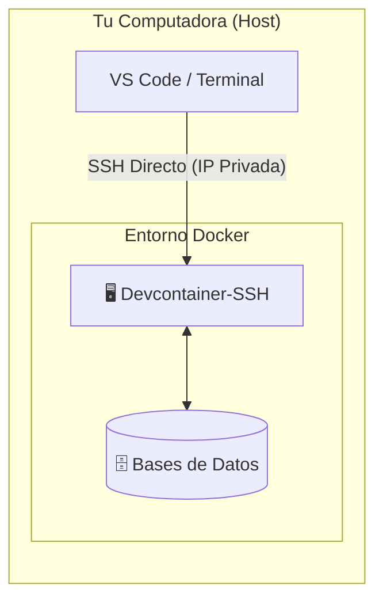
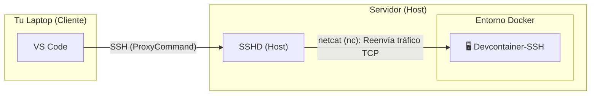
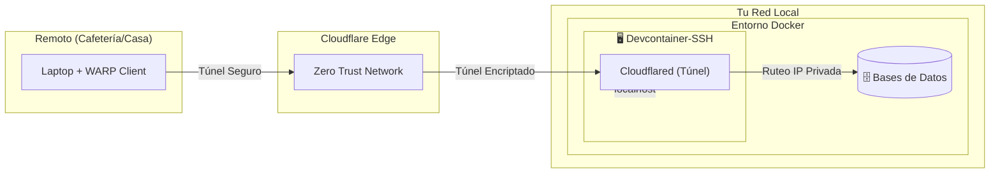

<div align="center">

# DevContainer Installer CLI

[](#)
[](#)
[](#)
[](#)

**Crea y gestiona entornos de desarrollo aislados en Docker desde un solo comando, sin instalar toolchains ni bases de datos en tu máquina.**

</div>

---

## ¿Qué es y para qué sirve?

`devcontainer-cli` genera, construye y opera contenedores Docker listos para programar o ejecutar tareas automatizadas.

Úsalo para:
- **Aislar proyectos**: cada repositorio tiene sus propias versiones de Node, Python, Go, Java, Rust o PHP y sus bases de datos (`postgres`, `redis`, `mongo`) sin conflictos en tu sistema.
- **Conectar tu editor o terminal en segundos**: configura acceso SSH automático para **VS Code Remote - SSH** o entra directo con `access shell` y `zellij`.
- **Probar cosas sin ensuciar tu equipo**: levanta un contenedor desechable con `run --profile <perfil>` y bórralo al terminar.
- **Darle un sandbox seguro a agentes de IA**: Claude Code, Antigravity, Codex, OpenCode y Copilot ejecutan builds, tests y comandos dentro del contenedor sin acceso `root` al host.

---

## Requisitos e Instalación

Requiere **Docker** en ejecución (Linux o macOS, `x64` / `arm64`).

```bash
curl -fsSL https://raw.githubusercontent.com/Joacohbc/my-devcontainer-installer/main/cli/install.sh | sh
```

> Binarios manuales disponibles en [GitHub Releases](https://github.com/Joacohbc/my-devcontainer-installer/releases/latest). El autocompletado para Zsh y Bash se configura al instalar.

---

## Primeros pasos (1 minuto)

### Opción A: Crear un entorno para tu proyecto

```bash
cd mi-proyecto

# 1. Elige lenguajes, bases de datos y herramientas en el asistente interactivo
devcontainer-cli

# 2. Levanta los contenedores
devcontainer-cli workspace up

# 3. Conéctate (elige SSH para VS Code/terminal o shell directa)
devcontainer-cli access ssh
# o:
devcontainer-cli access shell
```

Si quieres saltar la compilación local, usa una imagen precompilada de GHCR:

```bash
devcontainer-cli --profile nodejs
```

### Opción B: Contenedor temporal sin archivos de proyecto

```bash
devcontainer-cli run --profile python
```

---

## Uso con Agentes de IA

`devcontainer-cli` incluye el grupo `devcontainer-cli agent` (sin menús interactivos ni prompts) para que un asistente que corre en tu máquina ejecute código dentro del contenedor como `devuser`:

```bash
devcontainer-cli agent create --mode profiles --profile node-python --services postgres
devcontainer-cli agent exec -w -- go test ./...
devcontainer-cli agent forward 3000
devcontainer-cli agent destroy --yes
```

### Instalar la habilidad (skill) en tu agente del host (muy recomendado)

Enseña a Claude Code, Antigravity u otros agentes compatibles a usar `devcontainer-cli` automáticamente para no tocar tu máquina física:

```bash
# Con npx skills:
npx skills add Joacohbc/my-devcontainer-installer@devcontainer-cli -g
```

Sin `npx` (descarga directa de la carpeta de la habilidad):

```bash
# ~/.claude/skills/devcontainer-cli (Claude Code) o ~/.agents/skills/devcontainer-cli (Antigravity / OpenCode)
DEST=~/.claude/skills/devcontainer-cli
mkdir -p "$DEST" && \
curl -fsSL https://codeload.github.com/Joacohbc/my-devcontainer-installer/tar.gz/main | \
  tar -xz -C "$DEST" --strip-components=3 my-devcontainer-installer-main/skills/devcontainer-cli
```

---

## Componentes y Tecnologías Soportadas

| Categoría | Tecnologías y Herramientas | Descripción |
| :--- | :--- | :--- |
| **Runtimes y Lenguajes** | [](#) [](#) [](#) [](#) [](#) [](#) [](#) [](#) | Módulos dinámicos para Dockerfile con versiones configurables (`nvm`/`fnm`, Corepack, `rustup`, OpenJDK/Temurin, CMake). |
| **Gestores de Paquetes** | [](#) [](#) [](#) [](#) [](#) | Integración nativa con los gestores de paquetes más populares. |
| **Bases de Datos** | [](#) [](#) [](#) [](#) | Servicios orquestados en red privada (`postgres`, `mongo`, `redis`) o cliente local (`sqlite3`). Incluye clientes CLI opcionales (`psql`, `mongosh`, `redis-cli`). |
| **Agentes de IA y Herramientas** | [](#) [](#) [](#) [](#) [](#) | CLIs e instaladores integrados para Claude Code, Copilot CLI, Codex CLI, OpenCode y Antigravity CLI. |
| **Herramientas de Sistema** | [](#) [](#) [](#) [](#) | Docker-out-of-Docker (`/var/run/docker.sock`), `gh`, Chromium headless para testing/web scraping y FFmpeg para procesamiento multimedia. |
| **Red y Conectividad** | [](#) [](#) | Automatización de claves SSH, ProxyCommand para servidores remotos, túneles seguros con Cloudflare Zero Trust y gestión de puertos. |
| **Entorno de Terminal** | [](#) [](#) [](#) | ZSH con Oh My Zsh preconfigurado, multiplexor Zellij, editores `micro`/`nano` y manual integrado (`cat ~/help`). |

---

## Arquitectura y Topologías de Red

El entorno ofrece un contenedor principal (`devcontainer-ssh`) accesible vía OpenSSH en el puerto 2222, permitiendo conectar tu editor o terminal según el escenario de infraestructura:

<details>
<summary><b>1. Acceso Local (Host de desarrollo)</b></summary>

Conexión SSH directa a la IP privada del contenedor en el mismo equipo. No requiere exponer puertos al exterior.


</details>

<details>
<summary><b>2. Acceso Remoto LAN (Laptop → Servidor con --via)</b></summary>

Conexión desde una laptop a un servidor local (Raspberry Pi, Mini PC) usando el servicio SSH del servidor como puente seguro (`netcat`), sin exponer puertos del contenedor.


</details>

<details>
<summary><b>3. Acceso Remoto Seguro (Cloudflare Tunnel)</b></summary>

Acceso desde cualquier lugar mediante Cloudflare Zero Trust y cliente WARP sin abrir puertos en el router. `cloudflared` se instala **dentro** del devcontainer (módulo `cloudflared`), alcanzando `localhost` sin saltos de red. (Ver [.docs/cloudflare-tunnel.md](.docs/cloudflare-tunnel.md)).


</details>

---

## Comandos frecuentes

| Comando | Para qué sirve |
|---|---|
| `devcontainer-cli` | Abre el asistente para configurar el proyecto actual |
| `devcontainer-cli workspace up` | Construye (si hace falta) y levanta los contenedores |
| `devcontainer-cli access ssh` | Configura `~/.ssh/devcontainer-cli.config` y conecta por SSH (ideal para VS Code) |
| `devcontainer-cli access shell` | Abre una terminal Zsh directa dentro del contenedor |
| `devcontainer-cli access forward 3000` | Reenvía un puerto del contenedor a `127.0.0.1:3000` en tu máquina (`reverse:5432` en sentido inverso) |
| `devcontainer-cli access copy <orig> <dest>` | Copia archivos entre el host y el contenedor (`:` marca el lado del contenedor) |
| `devcontainer-cli inspect context` | Muestra herramientas instaladas, versiones y `~/CONTEXT.md` del contenedor |
| `devcontainer-cli workspace destroy` | Elimina contenedores, red y volúmenes del proyecto actual |

> ¿Necesitas dejar un proceso interactivo o TUI (como `claude --remote-control`) corriendo en segundo plano al salir de la shell? Consulta [UTILITIES.md](UTILITIES.md).

---

## Mantenimiento y solución rápida

<details>
<summary><b>Actualizar, desinstalar y problemas frecuentes</b></summary>

```bash
# Actualizar la CLI
devcontainer-cli config upgrade-cli

# Desinstalar la CLI
curl -fsSL https://raw.githubusercontent.com/Joacohbc/my-devcontainer-installer/main/cli/uninstall.sh | sh

# Limpiar entradas SSH antiguas o recursos Docker sin uso
devcontainer-cli config clean ssh -y
devcontainer-cli config clean all
```

- **Permission denied (publickey) / host key changed**: ejecuta `devcontainer-cli access ssh` para reparar claves o actualizar la IP registrada.
- **Credenciales compartidas entre contenedores**: usa `devcontainer-cli config shared sync` para persistir sesiones (`.claude`, `.codex`, `.gemini`, `.config/gh`, `.config/herdr`) en el volumen compartido.
- **Error de Docker socket (`dod`)**: verifica que el módulo `dod` esté activo y que `devuser` pertenezca al grupo `docker`.

</details>

---

## Guías de Uso

- [**`UTILITIES.md`**](UTILITIES.md) — Sesiones persistentes en segundo plano con Zellij (PTY) y procesos desacoplados.
- [**`MANUAL.md`**](MANUAL.md) — Casos de uso paso a paso (VS Code, servidores LAN con `--via`, bases de datos, agentes).
- [**`.docs/cli-reference.md`**](.docs/cli-reference.md) — Referencia completa de comandos y flags.
- [**`.docs/post-install.md`**](.docs/post-install.md) — Operaciones post-instalación y administración de bases de datos.
- [**`.docs/cloudflare-tunnel.md`**](.docs/cloudflare-tunnel.md) — Acceso remoto privado con Cloudflare Zero Trust y WARP.

> *¿Contribuir al desarrollo de la CLI?* La arquitectura, convenciones y flujo interno están en [`AGENTS.md`](AGENTS.md) y [`.docs/`](.docs/).
