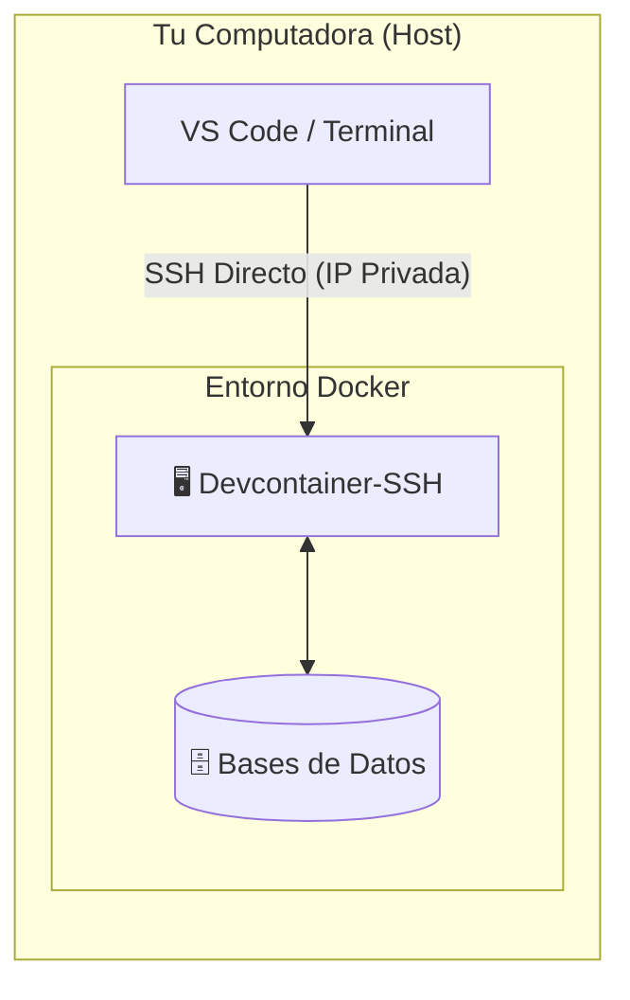
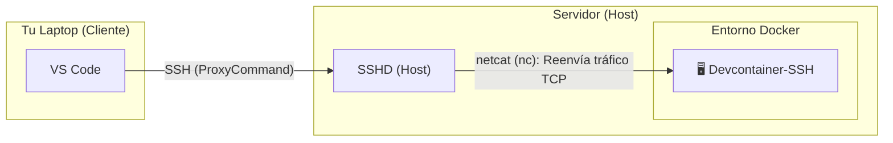
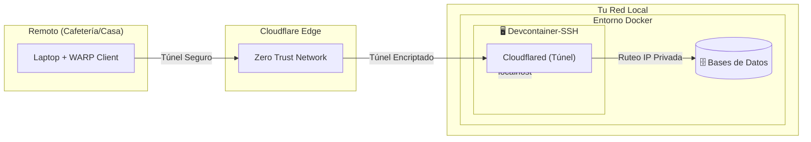

<div align="center">

# DevContainer Installer CLI

[](#)
[](#)
[](#)
[](#)
[](#)

*Automatiza la creación, orquestación y gestión de entornos aislados de desarrollo en Docker (DevContainers).*

</div>

---

## Resumen Ejecutivo

**DevContainer Installer CLI** (`devcontainer-cli`) es una herramienta interactiva, extensible y de alto rendimiento construida en Go. Elimina la fricción de configurar dependencias locales, resolver conflictos de versiones y adecuar la máquina física para cada proyecto: automatiza la creación, orquestación y gestión de entornos aislados de desarrollo en Docker (*DevContainers*).

Tanto para **desarrolladores humanos** (mediante un asistente interactivo TUI, acceso transparente por VS Code Remote - SSH y bases de datos integradas) como para **agentes autónomos de IA** (como Claude Code, Antigravity, Codex y Copilot, operando en un sandbox seguro como usuario regular sin permisos de root), `devcontainer-cli` garantiza máxima reproducibilidad y consistencia sin ensuciar el sistema operativo anfitrión.

---

## Instalación y Configuración Inicial

### 1. Instalación Rápida (Linux / macOS)
```bash
curl -fsSL https://raw.githubusercontent.com/Joacohbc/my-devcontainer-installer/main/cli/install.sh | sh
```
> **Descargas manuales:** Disponibles en los [Releases de GitHub](https://github.com/Joacohbc/my-devcontainer-installer/releases/latest) (binarios standalone para `linux-x64`, `linux-arm64`, `darwin-x64` y `darwin-arm64`). El autocompletado en Zsh y Bash se configura automáticamente tras instalar.

### 2. Habilidad de Host para Agentes de IA (Opcional, Muy Recomendado)
Enseña a los asistentes que corren en su máquina física (Claude Code, Antigravity, etc.) a operar esta CLI para que ejecuten builds, tests y migraciones dentro de contenedores:
```bash
npx skills add Joacohbc/my-devcontainer-installer@devcontainer-cli -g
```

### 3. Actualización y Desinstalación
```bash
# Actualizar la CLI a la última versión disponible
devcontainer-cli upgrade-cli

# Desinstalar la CLI por completo
curl -fsSL https://raw.githubusercontent.com/Joacohbc/my-devcontainer-installer/main/cli/uninstall.sh | sh
```

---

## Flujo Esencial en 60 Segundos

```bash
mkdir mi-proyecto && cd mi-proyecto

# 1. Generar la configuración del contenedor (asistente interactivo TUI)
devcontainer-cli

# 2. Levantar el stack de contenedores
devcontainer-cli up

# 3. Conectarse al entorno (elija SSH o Shell directa)
devcontainer-cli ssh         # Acceso SSH persistente (registra alias en ~/.ssh/devcontainer-cli.config)
# o bien:
devcontainer-cli shell       # Shell directa e interactiva vía docker exec (sin tocar configuración SSH)
```

---

## Guía Rápida por Rol

### 👤 Para Desarrolladores Humanos
- **Asistente TUI amigable**: Ejecute `devcontainer-cli` en la raíz de su proyecto y elija lenguajes, bases de datos y herramientas con la barra espaciadora.
- **Arranque instantáneo con perfiles**: Omita la compilación local usando imágenes precompiladas de GHCR con `devcontainer-cli --profile nodejs` (o `python`, `go`, `bun`, `node-go`).
- **Integración con VS Code**: `devcontainer-cli ssh` configura automáticamente sus claves en `~/.ssh/devcontainer-cli.config`. Abra VS Code, pulse `F1` -> *Remote-SSH: Connect to Host...* y elija el nombre de su proyecto.
- **Bases de datos listas**: Añada `--service postgres,redis` y conéctese con DBeaver o TablePlus desde el host en `127.0.0.1:5432`.

### 🤖 Para Agentes Autónomos de IA (Antigravity, Claude Code, Codex, Copilot)
- **Fachada desatendida y predecible**: El grupo `devcontainer-cli agent` nunca abre menús interactivos ni espera respuestas; si falta un parámetro, falla de forma inmediata y explícita.
- **Aislamiento seguro sin root**: `devcontainer-cli agent exec -w -- <comando>` ejecuta tareas estrictamente como `devuser`, impidiendo que se generen archivos propiedad de `root` en su checkout local.
- **Auto-orientación exacta**: Cada contenedor genera `~/CONTEXT.md` y `devcontainer-cli agent context --json`, informando al agente con exactitud qué herramientas, rutas y credenciales existen.
- **Entornos temporales desechables**: `devcontainer-cli agent create --temporal --profile python` crea un entorno efímero para reproducir incidencias y se destruye limpiamente con `agent clean`.

> 💡 **Manual Exhaustivo de Casos de Uso:** Consulte [`.docs/manual.md`](.docs/manual.md) para ver ejemplos paso a paso de cada flujo humano y agéntico.

---

## Componentes y Tecnologías Soportadas

| Categoría | Tecnologías y Herramientas | Descripción |
| :--- | :--- | :--- |
| **Runtimes y Lenguajes** | [](#) [](#) [](#) [](#) [](#) [](#) [](#) [](#) | Módulos dinámicos para Dockerfile con versiones configurables (`nvm`/`fnm`, Corepack, `rustup`, OpenJDK/Temurin, CMake). |
| **Gestores de Paquetes** | [](#) [](#) [](#) [](#) [](#) | Integración nativa con los gestores de paquetes más populares. |
| **Bases de Datos** | [](#) [](#) [](#) [](#) | Servicios orquestados en red privada (`postgres`, `mongo`, `redis`) o cliente local (`sqlite3`). Incluye clientes CLI opcionales (`psql`, `mongosh`, `redis-cli`). |
| **Agentes de IA y Herramientas** | [](#) [](#) [](#) [](#) [](#) [](#) [](#) | CLIs e instaladores integrados para Claude Code, Copilot CLI, Codex CLI, OpenCode y Antigravity CLI, junto a utilidades como `caveman` (compresión de contexto) y `graphify` (grafos de conocimiento). |
| **Herramientas de Sistema** | [](#) [](#) [](#) [](#) | Docker-out-of-Docker (`/var/run/docker.sock`), `gh`, Chromium headless para testing/web scraping y FFmpeg para procesamiento multimedia. |
| **Red y Conectividad** | [](#) [](#) [](#) | Automatización de claves SSH, ProxyCommand para servidores remotos, túneles seguros con Cloudflare Zero Trust, Ngrok y gestión de puertos. |
| **Entorno de Terminal** | [](#) [](#) [](#) | ZSH con Oh My Zsh preconfigurado, multiplexor Zellij, editores `micro`/`nano` y manual integrado (`cat ~/help`). |

---

## Arquitectura y Topologías de Red

El entorno ofrece un contenedor principal (`devcontainer-ssh`) accesible vía OpenSSH en el puerto 2222, permitiendo conectar su editor o terminal según el escenario de infraestructura:

<details>
<summary><b>1. Acceso Local (Host de desarrollo)</b></summary>

Conexión SSH directa a la IP privada del contenedor en el mismo equipo. No requiere exponer puertos al exterior.


</details>

<details>
<summary><b>2. Acceso Remoto LAN (Laptop → Servidor con --via)</b></summary>

Conexión desde una laptop a un servidor local (Raspberry Pi, Mini PC) usando el servicio SSH del servidor como puente seguro (`netcat`), sin exponer puertos del contenedor.


</details>

<details>
<summary><b>3. Acceso Remoto Seguro (Cloudflare Tunnel)</b></summary>

Acceso desde cualquier lugar mediante Cloudflare Zero Trust y cliente WARP sin abrir puertos en el router. `cloudflared` se instala **dentro** del devcontainer (módulo `cloudflared`), alcanzando `localhost` sin saltos de red. (Ver [.docs/cloudflare-tunnel.md](.docs/cloudflare-tunnel.md)).


</details>

---

## Flujo de Trabajo Diario y Operaciones

### 1. Acceso por SSH: Persistente vs. Efímero (`devcontainer-cli ssh`)
`devcontainer-cli ssh` abre una sesión OpenSSH interactiva en el puerto 2222 del contenedor. Ofrece dos modos de operación según la necesidad de persistencia:

- **Modo Persistente (`devcontainer-cli ssh`) [Recomendado para humanos y VS Code]**:
  - Registra el bloque `Host <workspace>` en **`~/.ssh/devcontainer-cli.config`**, manteniendo su `~/.ssh/config` intacto con una única línea `Include`. Cambie la ubicación con `devcontainer-cli config ssh-config-file <ruta>`.
  - **Fijación de claves de host (*Host-Key Pinning*)**: Las claves se leen por Docker y se registran en el `known_hosts` de la CLI; reconstruir la imagen nunca dispara advertencias de identidad alterada.
  - Permite conectarse desde cualquier terminal con `ssh <workspace>` o abrir el entorno en **VS Code Remote - SSH**.
  - Con `--setup` fuerza la regeneración y reparación de claves antes de conectar.

- **Modo Efímero (`devcontainer-cli ssh --ephemeral`) [Idóneo para agentes y CI/CD]**:
  - Se conecta directamente a la IP y puerto 2222 del contenedor mediante la clave privada gestionada (`-i ...`), **sin leer ni modificar `~/.ssh/config` ni `~/.ssh/devcontainer-cli.config`**.
  - No fija claves ni deja entradas huérfanas en el sistema anfitrión (**cero polución**).
  - Es el modo predeterminado para agentes de IA en `devcontainer-cli agent ssh`.

```bash
devcontainer-cli ssh                                          # SSH persistente: configura alias y conecta
devcontainer-cli ssh --ephemeral                              # SSH efímero: conecta directo sin tocar archivos SSH
devcontainer-cli ssh --setup                                  # Fuerza regeneración de claves y bloques
devcontainer-cli ssh --via user@docker-host --container dc-ssh # Conexión a contenedor en OTRO host vía salto SSH
ssh mi-proyecto                                                # Conexión directa mediante alias tradicional (modo persistente)
```
> `--via` (requiere `--container`) es idóneo para servidores remotos en LAN: la clave privada nunca sale de su máquina cliente. En contraste, `--setup-external USER@HOST` corre en el servidor e imprime un snippet autocontenido para pegar en el cliente.

### 2. Acceso por Shell Directa (`devcontainer-cli shell`)
Utiliza `docker exec` internamente resolviendo automáticamente el contenedor del espacio de trabajo actual, sin requerir OpenSSH ni configuración de claves:
- **Modo interactivo**: Abre una terminal Zsh interactiva con soporte TTY completo.
- **Ejecución puntual o tuberías (`-T` / `--no-tty`)**: Desactiva el pseudo-terminal para evitar caracteres de control (`\r`) en redirecciones de archivos, scripts o volcados de bases de datos.
- **Acceso a contenedores secundarios (`-c <contenedor>`)**: Permite entrar a servicios auxiliares (ej. `postgres`, `redis`).

```bash
devcontainer-cli shell                                        # Entra a la shell interactiva (Zsh)
devcontainer-cli shell -- bash                                # Abre la shell especificando bash
devcontainer-cli shell -c mi-proyecto-postgres                # Entra directo al contenedor de la base de datos
devcontainer-cli shell -- uname -a                            # Ejecuta un comando puntual y retorna su salida
devcontainer-cli shell -T -- pg_dump -U devuser devdb > dump.sql # Dump limpio de base de datos sin corrupción TTY
```

### 3. Reenvío de Puertos y Túneles Inversos (`port-forward`)
Permite conectar servicios en ambas direcciones entre el anfitrión y el contenedor:
```bash
devcontainer-cli port-forward 3000                 # Forward directo: escucha en 127.0.0.1:3000 del host
devcontainer-cli port-forward reverse:5432         # Túnel inverso: el host adentro en localhost:5432
```

### 4. Copiar Archivos y Assets (`copy`)
Copia archivos hacia/desde el contenedor o materializa instaladores embebidos:
```bash
devcontainer-cli copy ./app.go :/home/devuser/app.go         # Host -> Contenedor
devcontainer-cli copy --asset install-claude-code             # Materializa instalador de IA en el contenedor
```

### 5. Bases de Datos Integradas
Credenciales predeterminadas para los servicios complementarios (Usuario: `devuser` | Contraseña: `devpass`):
- **PostgreSQL:** `psql -h postgres -U devuser -d devdb`
- **MongoDB:** `mongosh --host mongo -u devuser -p devpass --authenticationDatabase admin`
- **Redis:** `redis-cli -h redis`

```bash
# Reiniciar el esquema de PostgreSQL sin reiniciar el contenedor
devcontainer-cli shell -c <workspace>-postgres -- psql -U devuser -d devdb -c "DROP SCHEMA public CASCADE; CREATE SCHEMA public;"

# Backup limpio sin corrupción de TTY (el flag -T es obligatorio)
devcontainer-cli shell -c <workspace>-postgres -T -- pg_dump -U devuser --no-owner --no-acl devdb > backup.sql
```
> Más detalles de administración de BD en [.docs/post-install.md](.docs/post-install.md).

---

## Configuración Compartida y Personalización

### 1. Sincronizar Credenciales de IA y GitHub (`config shared`)
El volumen `devcontainer-shared-config` persiste inicios de sesión (`.claude`, `.codex`, `.gemini`, `.config/gh`) compartiéndolos entre todos los contenedores:
```bash
devcontainer-cli config shared sync                           # Sembrar sesiones del host al volumen
devcontainer-cli config shared backup -o backup.zip            # Respaldar volumen a un archivo .zip
devcontainer-cli config shared restore backup.zip              # Restaurar volumen desde un archivo .zip
```

### 2. Aliases Globales Persistentes (`config alias`)
La imagen incluye alias útiles por defecto: `kill_port <puerto>`, `npm`→`pnpm`, `pip`→`uv pip` y lanzadores `<tool>_yolo` que ejecutan CLIs de IA sin pausas de permisos.

Puede definir sus propios alias globales que se propagan a **todos** los contenedores sin recompilar imágenes:
```bash
devcontainer-cli config alias                    # Listar alias configurados
devcontainer-cli config alias set ll "ls -la"    # Crear o actualizar un alias
devcontainer-cli config alias unset ll           # Eliminar un alias
devcontainer-cli config alias sync               # Sincronizar hacia el volumen compartido
```

### 3. Conectar Otros Contenedores a la Red (`network`)
Integre cualquier contenedor externo al stack privado del proyecto:
```bash
devcontainer-cli network connect mi-servicio-externo --alias db-externa
```

---

## La Capa de Agentes de IA

### 1. Fachada Desatendida (`devcontainer-cli agent`)
Diseñada específicamente para que agentes autónomos operen sin riesgo de colgarse en prompts ni corromper permisos:
```bash
devcontainer-cli agent cli-info --json                        # Catálogo estructurado de capacidades
devcontainer-cli agent create --profile node-python --service redis # Crear y levantar stack sin TUI
devcontainer-cli agent exec -w -- go test ./...                # Ejecutar comando como devuser en el workspace
devcontainer-cli agent forward 8080                           # Reenviar puerto para pruebas o web preview
devcontainer-cli agent context --json                         # Diagnóstico de herramientas y versiones
devcontainer-cli agent clean                                  # Limpiar stack e imagen construida del proyecto
```

### 2. Contexto Dinámico (`~/CONTEXT.md` y Habilidad Global)
Cada contenedor genera un `~/CONTEXT.md` único que describe exactamente los módulos, variables y credenciales activas. Además, incluye la habilidad global preinstalada **`devcontainer-context`** (enlazada en `~/.agents/skills` y `~/.claude/skills`), recordando a los agentes las reglas invariantes: editar solo en el workspace, consultar bases de datos por su nombre de servicio de compose y utilizar `sudo` sin contraseña.

---

## Higiene y Mantenimiento (`clean` y `destroy`)

```bash
# Limpiar bloques SSH obsoletos y entradas huérfanas en known_hosts
devcontainer-cli clean ssh -y

# Menú interactivo o limpieza completa de contenedores/imágenes/redes en desuso
devcontainer-cli clean all

# Destruir completamente el devcontainer del proyecto actual y sus volúmenes
devcontainer-cli destroy
```

---

## Solución de Problemas Frecuentes

<details>
<summary><b>Permission denied (publickey)</b></summary>

- Ejecute `devcontainer-cli ssh` para verificar y reinstalar automáticamente la clave pública gestionada en `~/.ssh/authorized_keys` dentro del contenedor.
- Si modificó los archivos manualmente en el contenedor, asegure los permisos requeridos: `chmod 700 ~/.ssh` y `chmod 600 ~/.ssh/authorized_keys`.
</details>

<details>
<summary><b>Connection refused o cambio de IP / host key</b></summary>

- Confirme que el contenedor esté activo mediante `devcontainer-cli status` o `devcontainer-cli compose ps`.
- Si se reconstruyó la imagen o cambió la IP, ejecute `devcontainer-cli ssh`: la CLI detecta el cambio, actualiza la IP y re-fija automáticamente la host key en su archivo de configuración gestionado.
</details>

<details>
<summary><b>Error de Socket de Docker (DoD) dentro del contenedor</b></summary>

- Verifique que el módulo `dod` esté habilitado y que `.dc_<workspace>/build/docker-compose.yml` contenga el montaje `- /var/run/docker.sock:/var/run/docker.sock`.
- Asegure que el usuario `devuser` pertenezca al grupo `docker` dentro del contenedor.
</details>

---

## Documentación Detallada

Para profundizar en la arquitectura interna, decisiones técnicas y guías de desarrollo, consulte la documentación oficial en [`.docs/`](.docs/):

| Documento | Contenido Principal |
|---|---|
| [**`.docs/manual.md`**](.docs/manual.md) | **Manual Práctico de Casos de Uso** detallado para humanos y agentes de IA con comandos exactos. |
| [**`.docs/product.md`**](.docs/product.md) | Visión de producto, personas y flujos funcionales de extremo a extremo. |
| [**`.docs/architecture.md`**](.docs/architecture.md) | Arquitectura en 4 capas, contratos de aislamiento e inventario de decisiones D1–D13. |
| [**`.docs/domain-model.md`**](.docs/domain-model.md) | Entidades, catálogo de módulos Dockerfile, servicios Compose y perfiles. |
| [**`.docs/code-conventions.md`**](.docs/code-conventions.md) | Directivas `hbc-code-design`, convenciones Go y autoría de comandos Cobra. |
| [**`.docs/dev-environment.md`**](.docs/dev-environment.md) | Entorno local, GitHub Actions, GoReleaser y auto-actualización. |
| [**`.docs/testing.md`**](.docs/testing.md) | Pirámide de pruebas, simulación de Docker con fakes y tests de invariantes. |
| [**`.docs/cloudflare-tunnel.md`**](.docs/cloudflare-tunnel.md) | Guía de configuración de redes privadas Zero Trust y cliente WARP. |
| [**`.docs/post-install.md`**](.docs/post-install.md) | Pasos posteriores a la instalación, scripts embebidos y gestión de bases de datos. |
| [**`.docs/roadmap.md`**](.docs/roadmap.md) | Lista viva de tareas, decisiones abiertas, visión y deuda técnica. |
| [**`.docs/context.md`**](.docs/context.md) | Glosario de vocabulario ubicuo y conceptos de negocio. |
| [**`AGENTS.md`**](AGENTS.md) | Constitución ejecutiva y reglas inviolables para agentes de IA que operan en este repositorio. |
